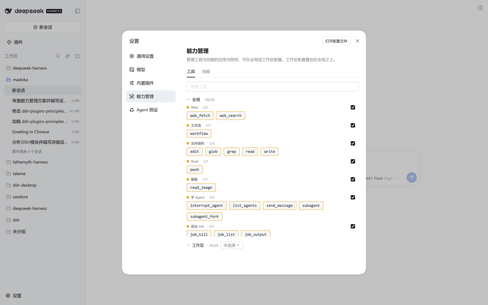

# madoka

本仓库只收录一个插件：[`dsh-magica-rune`](dsh-magica-rune/) —— DSH 的能力管理插件，
用来按**全局 / 工作区**启用与禁用任意工具和技能。



## 安装

```bash
dsh plugin --profile web add @meiyukichan/dsh-magica-rune
```

装好后重启 `dsh web`，在 **设置 → 能力管理** 里就能看到开关面板。

## 它做什么

- 被禁用的工具会从模型的**工具清单**和**系统提示词**里同时消失，调用时再兜底拒绝；
- 被禁用的技能不再出现在技能目录里；
- 支持两级作用域（全局 / 单个工作区）、搜索、按分类分组批量开关；
- 内置保护项（如 `run_code`）不可禁用；
- 改动即时生效，不需要重启。

细节见 [插件说明](dsh-magica-rune/README.md)，设计与审计见[设计文档](dsh-magica-rune/docs/README.zh.md)。

## 开发

```bash
cd dsh-magica-rune
pnpm install
pnpm build        # 产出 lib/index.js（host）与 lib/client.js（client）
pnpm test         # 单元测试
pnpm typecheck
pnpm e2e          # 端到端（Playwright，真开浏览器点页面）
```

## 许可

[MIT](LICENSE)
