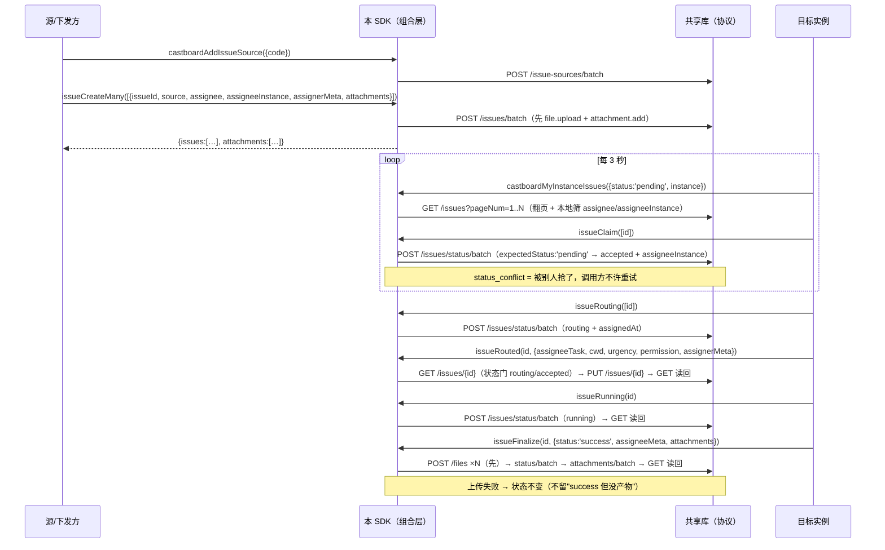
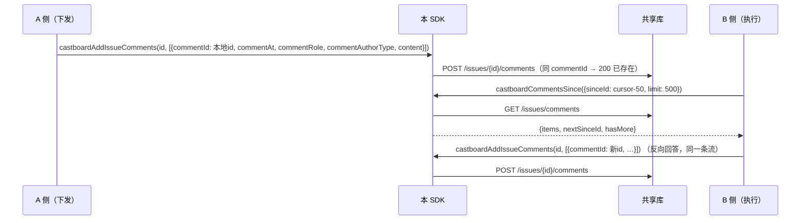

# dsh-teamwork · SDK 设计（`dsh-teamwork/1` 协议面 + 兼容面）

> **本文定义 `src/sdk/**` 的全部内容。** 它是 `src/server`（参考实现）对外契约的客户端侧：
> 一层**协议面**（47 个端点 1:1），一层**组合面**（24 个协同语义方法 + 1 个扩展），
> 两者都返回结果信封、永不抛异常。
>
> 文档分工：
>
> | 文档 | 定义什么 | 谁改 |
> |---|---|---|
> | [`api-design.zh.md`](./api-design.zh.md) | **线上契约**：47 个端点的路径 / 入参 / 出参 / 状态码 / 错误码 | 改服务端行为才改 |
> | [`open-items.zh.md`](./open-items.zh.md) | **待办与未决项**（协议未定的缺口；如 TODO-1 审批/提问的待决交互通道） | 有新缺口就加 |
> | **本文** | **`src/sdk` 的实现规格**：文件结构、端点表、类型、原子层、组合层、测试契约 | 改 SDK 才改 |
>
> **一句话**：`src/sdk` = 一个**面向协议而不是面向本仓 server 进程**的客户端库——
> 只要别人的自部署服务遵守 `api-design.zh.md` 的路径 / 字段 / 状态码 / 两个鉴权头 / HS256 形态，
> SDK 不改一行就能连上去；`src/server` 只是**参考实现之一**。
>
> **兼容面**：24 个组合方法与 32 个端点名沿用既有的协同 API 形状（方法名、入参、返回信封都保持稳定），
> 内部实现全部映射到本协议。调用方按既有方法名写的业务代码不需要重写。

**目录**

| 章 | 内容 | 谁读 |
|---|---|---|
| §0 | 定位、决策登记（D1–D26）、**这个 SDK 是协同底座** | 所有人先读 |
| §1–§2 | 协议依赖边界、14 条不变量 | 实现者 |
| §3–§6 | 文件结构、baseUrl/domain、会话鉴权、信封与错误码 | 实现者 |
| §7 | **端点表（48 表项 / 47 端点）** + 兼容面32 个端点名逐条映射 | 实现者、评审 |
| §8–§9 | 线格式与类型、**原子层 50 个方法签名** | 实现者 |
| **§10** | **组合层 24 个方法（+E1）**：调用方地图（§10.0）、时序图、逐个规格 | **最重要，插件作者必读** |
| §11–§13 | 请求管线、环境与实例、运行期文案（逐字） | 实现者 |
| §14 | 兼容面差异 + **插件接入必查清单** | 插件作者 |
| §15–§17 | 包内既有 `TeamworkClient` 的处置、测试契约（含端到端剧本）、落地顺序 | 实现者、排期 |
| §18 | 非目标与已知限制 | 所有人 |

---

## 0. 定位与决策登记

### 0.1 这套 SDK 到底是什么

```
                    ┌─────────────────────────────────────────────┐
   调用方（插件/脚本）│  client.issueCreate(...)   ← 组合层（24 个语义方法）
                    │  client.issue.submit(...)  ← 原子层（协议面 1:1）
                    └──────────────────┬──────────────────────────┘
                                       ▼
                          CastboardTransport（一条请求管线）
                     URL 拼装 / JWT 现签 / 并发闸 / 超时 / 重试 / 错误归一
                                       ▼
                         HTTP + dsh-teamwork/1 协议（§7 端点表）
                                       ▼
        ┌──────────────────┬──────────────────────┬─────────────────────┐
        │ 本仓 src/server   │ 别人的自部署实现      │ 未来的 Go/Java 版    │
        │ Fastify + SQLite │ 任意语言 + 任意存储    │ 只要守协议即可        │
        └──────────────────┴──────────────────────┴─────────────────────┘
```

三个必须记住的事实：

1. **SDK 的 `data` 就是协议里的响应体**，不是服务端内部结构。任何字段语义都以 `api-design.zh.md` 为准。
2. **SDK 不 import `src/server` 的任何运行时模块**（类型也自带一份）。否则"服务端可替换"就是空话，
   而且 server 的内部重构会连带打断 SDK。
3. **一个 `CastboardClient` 实例 = 一份会话 + 一个并发闸 + 一套连接**。不要给每个分组各造一个 client。

### 0.2 决策登记（勿单方面推翻）

| # | 决策 | 取值 | 理由 |
|---|---|---|---|
| **D1** | SDK 面向 | **协议面**（`dsh-teamwork/1`），不是本仓 server 的类 | 服务端可替换是需求本身；本仓 server 只做参考实现 |
| **D2** | API 形态 | **双面**：原子层（47 端点 1:1）+ 组合层（兼容面的 24 个语义方法） | 原子层给"完全控制"，组合层给"少写代码"；两者同一 client |
| **D3** | 命名 | 原子层端点名 / 方法名**沿用兼容面**（`issueSubmit` / `issue.submit` / `issueCreate`…）；新增的用 `dsh-teamwork` 风格 | 旧调用方零改名成本；差异集中记录在 §14 |
| **D4** | 鉴权 | 完全走本协议：`dsh-teamwork-token`（现签 HS256 JWT）+ `dsh-teamwork-account`；凭据只落 `accountToken` | 兼容面的 `x-auth-token` / `user_id` 方案**整体废弃** |
| **D5** | baseUrl | 解析链 `显式参数 > DSH_TEAMWORK_URL > DSH_TEAMWORK_HOST/PORT > <dataDir>/config.json > 127.0.0.1:3939`；前缀默认 `/dsh-teamwork/v1` | 与 `src/server/config.ts` 同源，拿不到参数时也能连上本机 server |
| **D6** | 信封 | 全部返回 `CastboardResult<T>`，**永不抛异常**（`dispose()` 不抛） | 调用方几乎全是后台任务，漏一个 `try/catch` 就是未处理 rejection |
| **D7** | `issueId` | **不强制 UUID**：非空、`trim` 后 1..100、不含控制字符 | 服从 DB：`ck_tw_issue_id_len CHECK (length(issue_id) BETWEEN 1 AND 100)`；兼容面的 UUID 硬约束属于原协议服务端 schema，在这里会把 `dsh:<host>:<uuid5>` 这类语义键挡在门外。UUID 是本规则的**子集**，旧调用方零成本 |
| **D8** | 附件类型 | 对外 `input` / `output`（兼容面能力），上线映射 `assigner` / `assignee`；也**接受**直接传 `assigner`/`assignee`（原样透传） | 服从 DB：`ck_tw_attachment_type CHECK (type IN ('assigner','assignee'))`；门面形状保留是为了 兼容面调用方 |
| **D9** | `title` / `detail` | 组合层接受顶层 `title`/`detail`，缺省从 `assignerMeta.title`/`.detail` 兜底；写库落到真列，`assignerMeta` 原样保留 | 服从 DB：`title TEXT NOT NULL` / `detail TEXT`（兼容面没有这两列，只能塞 meta；我们有真列，两种写法都要能跑） |
| **D10** | `permission` | `''` → `null` | 服从 DB：`ck_tw_issue_permission CHECK (permission IS NULL OR permission IN ('read-only','workspace-write','danger-full-access'))` |
| **D11** | 分页 | 协议一律 `pageNum`；`issue.list()` 出参同时给 `page` 与 `pageNum` | 兼容面的 `CastboardIssuePage.page` 与 teamwork 的 `pageNum`；DB 无分页概念，形状按 `api-design` §0.5 |
| **D12** | 原子层返回形状 | 一律返回**协议真实形状**（DB 行的 camelCase 投影） | 兼容面里若干原子方法回 `number`/`boolean`（影响行数、成功位），那是原协议服务端的省略写法；我们的 C 组直接回 `IssueVo`/`CommentVo`/`WorkspaceVo`。能力不减，信息更多 |
| **D13** | 组合层 `issueCreate` 撞已有 `issueId` | 默认 `onExist:'skip'`（读一次、一致即跳过并返回现有记录）；`'overwrite'` 才重发 | 服从服务端语义 + 补回旧护栏：C1 的 upsert 会把 `status` 打回 `pending` 并清空 `assignee_instance/assignee_meta`（`service.ts::upsertOne` 的 UPDATE 分支），默认重放等于把别人正在跑的活踢回待认领。兼容面里"不再有 pending 守卫"是原协议服务端的**退步**，SDK 层补回来 |
| **D14** | 匿名下载 | `file.downloadPublic()` 保留为 `download()` 的**别名**，不新增端点 | 服从协议：F2 只要签名头，没有匿名口 |
| **D15** | 重试 | 只对**幂等**请求重试（GET/PUT/DELETE；带 `issueId` 的 C1、带 `commentId` 的 C9）；`POST /files` 不重试 | 上传重试会写出孤儿文件（F1 无幂等键） |
| **D16** | 并发 | 出站并发上限 **4**（`CASTBOARD_DEFAULT_MAX_CONCURRENCY`） | dsh web 单 Node 进程，libuv 线程池 4 槽；否则所有 HTTP handler 排队 |
| **D17** | 依赖 | 运行时依赖：`@meiyukichan/dsh-magica-spellbook`（出站 + 日志 + JSON 路由，**已发布 0.2.0-alpha.1**）+ 既有 `fastify` / `@sinclair/typebox`；**不引 dsh 运行时** | 这三件事不自己造第二套：出站细节（TLS/代理/闸）、`EventLogger`、`createJsonRouter`；本包产物仍只 `lib/index.js`（发布包走 `external`） |
| **D18** | `assigner`（下发人） | 组合层**接受**该入参，但必须等于当前登录账号；不等 → 本地 `invalid_body` 零请求 | 服从鉴权：DB `assigner TEXT NOT NULL` 由服务端填 token 账号（`upsertOne` 里写的是 `user.accountId`），请求体出现 `assigner` → `400 unknown_field`。**这是有意的能力收紧**：本协议下"代他人派活"不存在，替代做法是用对方账号的实例上报，或用 `source`/`assignerMeta` 记录来源 |
| **D19** | 单条查询的可见性 | `issue.get()` 对所有登录用户返回数据；依赖门禁改为**显式判 `status`**，并新增扩展组合方法 `E1 castboardIssueStatuses(ids)` | 服从协议：C 组明确不做资源级鉴权（`api-design` §5.0「全部 16 个 C 端点都不管」）。兼容面靠 404 判"查不到"的做法在这里**恒不触发**，必须换判据，否则门禁静默失效 |
| **D20** | 轮询友好 | 组合方法一律"**一拍一次**"：不内部 sleep、不重试到成功、不等待远端变化 | 插件用 3s/5s 轮询驱动；方法内再循环会让拍与拍重叠且不可取消 |
| **D21** | 逃生口 | 保留 `client.request<T>(path, options)`；并导出 `CastboardTransport`（`call`/`callRaw`/`request`/`raw`） | 兼容面有这层能力（`roleOf()` 就是用法）；新能力仍优先补端点表 |
| **D22** | 优先级与取舍口径 | **兼容面 = 能力清单（全收纳），`src/server` = 形状标准（全服从）**；两者冲突时**形状服从 server、能力不丢**，差异逐条记在 §14 | 兼容面是**能力来源**（方法名/入参/返回信封保持稳定），本协议是**形状来源**（路径/字段/状态码/DB 列） |
| **D23** | 组合方法总数 | **24（兼容面全部）+ 1 个扩展 `E1 castboardIssueStatuses`**；扩展一律 `E` 前缀，与 24 分开计数 | 24 个必须全在（协同插件的调用点全落在这 24 个上）；E1 补的是 兼容面里插件手写的依赖门禁，属于"能力收纳"而不是发明新业务 |
| **D24** | 枚举以 DB CHECK 为准 | 成员角色 = `owner`/`manager`/`member`（**收掉 兼容面的 `creator`**）；设备无 `dshPatcherVersion`；成员无 `dept` | 服从 DB 三张 CHECK：`ck_tw_member_role`、设备 9 列、成员 6 列。多一个枚举值等于多一段永远走不到的分支 |
| **D25** | 兼容面的注入能力全保留、语义映射 | `userId` → 组合层的身份兜底（`castboardMyInstanceIssues` 等）；`tokenProvider` → 返回 `{accountId, accountToken, ttlSeconds?}` 的提供器；`invalidateToken` → `onTokenInvalid()`；`fetchImpl`/`timeoutMs`/`maxConcurrency` 原样 | 兼容面把这些当"外部依赖接缝"，测试与 CI 全靠它；我们的鉴权换了，但**接缝不能少**（§5.6 全表） |
| **D26** | 请求体只发 DB 可写列 | 每个端点用白名单投影（§8.6）；`assigner`/`createdBy`/`author`/`accountId` 这类身份列**永不进 body** | 服从服务端 strict schema（未声明字段一律 400）与 `api-design` §0.4.1 的"身份字段禁止出现在请求体" |

---

### 0.3 这个 SDK 是协同底座（谁在用它）

`dsh-magica-castboard` 的三条协同维度，最终都落到本 SDK 的**组合方法**上：

| 协同维度 | 难题 | 插件侧机制（不在本 SDK） | 本 SDK 提供的支撑 |
|---|---|---|---|
| **多实例**（同一人，多台机器） | 写者唯一、认领仲裁 | 存储目录租约 `StorageLease`、启动对账 | `issueClaim`（`expectedStatus:'pending'` CAS）、`castboardMyInstanceIssues`（只拉本机）、`castboardUserDevices` / `teamworkInstanceName()`（实例口径） |
| **多人**（下发方 ⇄ 执行方） | 消息送到"对端那个会话" | 关系表 + 评论流 jsonl + 三档投递 | `castboardAddIssueComments`（评论上云，`commentId` 幂等）、`castboardCommentsSince`（增量拉回）、`castboardIssueComments` |
| **多目标系统**（一个事件源 = 一个系统） | 幂等 + 边界 | 源插件只做"翻译"、`issue_sources` 字典 | `issueCreateMany`（唯一写入口）、`castboardAddIssueSource` / `castboardIssueSources`、`issueId` 幂等键 |
| ——（贯穿） | 一件活的生命周期 | 本地台账是权威、远端是镜像 | `issueRouting` → `issueRouted` → `issueRunning` → `issueFinalize` / `issueAbandon` 五件套 |
| ——（贯穿） | 派活四步（人/机/项目/目录） | `castboard_issues_*` 工具 | `castboardMyProjects` / `castboardProjectMembers` / `castboardUserDevices` / `castboardWorkspaceIndexes` / `castboardWorkspacePortal` |

**一条硬分工**：本 SDK **不做**轮询、不做台账、不做会话编排。它只保证"一次调用、一个结果、一个可判别的失败原因"，
让插件把"什么时候调、失败怎么降级"写成自己的策略（见 §10.0 的调用方地图）。

---

## 1. 协议优先：SDK 依赖什么 / 不依赖什么

### 1.1 SDK 依赖的（改了就连不上）

| 契约项 | 取值 | 出处 |
|---|---|---|
| 路径前缀 | `/dsh-teamwork/v1`（可由 `options.prefix` 覆盖） | `api-design` §0.1 |
| 字段命名 | 请求 / 响应一律 `camelCase` | `api-design` §0.1 |
| 时间格式 | ISO-8601 UTC 毫秒 `2026-11-11T11:05:54.829Z` | `api-design` §0.1 |
| 两个鉴权头 | `dsh-teamwork-token`（HS256 JWT）+ `dsh-teamwork-account` | `api-design` §0.2 |
| JWT 形态 | `header.payload.signature`；payload 只含 `{a, iat, exp}`；密钥 = `accountToken` | `api-design` §0.2 |
| `accountToken` | `SHA256(utf8(accountId + ":" + 明文密码))`，64 位小写 hex | `api-design` §0.3 |
| 密码字段 | **base64(UTF-8)**；SDK 边界收明文、发请求前编码 | `api-design` §0.3 |
| 错误体 | `{ code, message, details?, requestId? }`；`code` 是契约 | `api-design` §0.4 |
| 严格请求体 | 未声明字段一律 `400 unknown_field` | `api-design` §0.4.1 |
| 分页 | 入参 `pageNum`/`pageSize`（默认 1/20、上限 200）；出参 `{total,pageNum,pageSize,items}` | `api-design` §0.5 |
| 能力探测 | `GET /version` 的 `protocol === 'dsh-teamwork/1'` 与 `endpoints[]` | `api-design` §8.2 |

### 1.2 SDK 不依赖的（换实现随便改）

DB 引擎与表名、进程模型、端口、是否 `bin` 启动、限流参数、鉴权缓存 TTL、`message` 文案、
分页实现、文件落盘方式、日志格式。

### 1.3 别人的自部署服务怎么对接（SDK 侧视角）

| 步骤 | 做法 |
|---|---|
| 1 | `GET /version` → 必须回 `{"protocol":"dsh-teamwork/1", endpoints:[...]}`；不匹配 → `incompatible_server`（不猜、不降级兼容） |
| 2 | SDK 用 `endpoints[]` 做能力过滤：端点不在清单里时，对应方法返回 `unsupported`（零请求） |
| 3 | 只要两个头 + HS256 验签 + `accountToken` 语义对，`login()` 就能拿到 `accountToken`，之后所有调用自动可用 |
| 4 | 前缀不同（比如 `/v1/teamwork`）→ 构造时传 `prefix: '/v1/teamwork'`，或直接给完整 `baseUrl` |
| 5 | 端到端验收：`node scripts/saturate.mjs <url>`（现有脚本，按 `/version` 反查覆盖率） |

> **不许**在 SDK 里写 `if (baseUrl.includes('127.0.0.1'))` 这类分支。参考实现与其他实现必须走同一条代码路径，
> 否则"可替换"只是文档里的一句话。

---

## 2. 被固化的不变量

| 编号 | 不变量 | 落点 |
|---|---|---|
| INV-1 | **永不抛异常**：所有对外方法返回 `CastboardResult` 信封；组合层再兜一层 `guard()` | `result.ts`、`sdk.ts` |
| INV-2 | **一个方法对一个端点，不多不少**；48 条表项覆盖 47 个协议端点 | `endpoints.ts` + 单测断言 |
| INV-3 | **端点表是唯一真源**：方法体不出现手写路径字面量 | `transport.call(name)` |
| INV-4 | **出站并发上限 4**，与是否注入自定义 `fetch` 无关 | `transport.ts` |
| INV-5 | **`issueId` 是幂等键**，形状不合格在入口拦下且**零请求** | `wire.checkIssueId()` |
| INV-6 | **线格式翻译只在一处**：`dependsOn`(string[]↔JSON 文本)、附件类型(input/output↔assigner/assignee)、分页(page↔pageNum) | `wire.ts` |
| INV-7 | **只做"接口层 + 语义组合层"**：原子层 1:1 封端点，组合层只把端点按固定顺序拼一次；轮询 / 本地台账 / 执行闭环**不在本层** | `index.ts` 文件头、§10.0 |
| INV-8 | 一个 `CastboardClient` = **一份会话 + 一个并发闸 + 一套连接** | `client.ts` |
| INV-9 | **本地校验不合格则零请求** | `wire.ts`、`sdk.ts` 校验块 |
| INV-10 | **不依赖 dsh 运行时**：不接收 `ctx`、不 `import @deepseek-ai/*`、不 import `src/server` | 全部 import |
| INV-11 | 副作用可逆：`dispose()` 幂等且不抛 | `transport.dispose()` |
| INV-12 | 读回的 `dependsOn` **恒为 `string[]`**，脏数据归一成 `[]` | `wire.parseDependsOn()` |
| INV-13 | **`accountToken` 是唯一落盘机密**；`authToken` 每请求现签，永不落盘 | `auth.ts`、`credentials.ts` |
| INV-14 | **协议可选能力不硬依赖**：`/version` 没声明的端点，方法返回 `unsupported` 而不是乱发请求 | `transport.call()` |

---

## 3. 文件结构

**落地位置**：新 SDK 直接在 `src/sdk/**` 根下（没有 `castboard/` 之类的中间目录）。

- `src/sdk/legacy/`：包内既有 `TeamworkClient` 的 `client.ts` / `types.ts`（按 §15 先并存、后适配、再删除）；
- `src/sdk/credentials.ts`：AES-256-GCM 凭据存储，**两层共用**，不搬不改。

```
src/sdk/
├── index.ts            门面：createCastboardClient() + 全部再导出            ~37 行
├── client.ts           CastboardClient：底座 + 8 分组 + 24 组合方法 + E1 + request() + dispose  ~412 行
├── transport.ts        一条请求管线：URL/JWT/闸/超时/重试/非2xx 归一          ~551 行
├── endpoints.ts        48 条端点表（唯一真源）                                ~147 行
├── result.ts           信封 + CastboardErrorCode（76 个已知码 + 兜底）           ~175 行
├── types.ts            线格式类型 + 枚举三件套 + 运行期守卫                    ~525 行
├── wire.ts             线格式翻译 + 入参校验助手                              ~321 行
├── env.ts              baseUrl / 实例身份 / 本机 IP / 环境变量               ~369 行
├── auth.ts             会话状态机 + 现签 JWT + 401 四分支                     ~245 行
├── auth-api.ts         账号端点（A1–A6）                                      ~157 行
├── net.ts              出站门面：**用发布包的 createProxyFetch/createLimitedFetch** + 模式分流 ~219 行
├── log.ts              日志接缝：**用发布包的 EventLogger**（无 logger 时 console 兜底）       ~44 行
├── credentials.ts      AES-256-GCM 凭据文件（**两层共用**，不搬不改）          现有 175 行
├── file.ts             F1–F3                                                ~110 行
├── device.ts           B11 / B12                                             ~72 行
├── project.ts          B2 / B7（只读视图）                                    ~70 行
├── issue/
│   ├── index.ts        子系统出口                                             ~45 行
│   ├── issue.ts        C1–C6                                                 ~330 行
│   ├── attachment.ts   C11 / C12                                             ~80 行
│   ├── comment.ts      C7–C10                                                ~180 行
│   ├── source.ts       C13–C16                                               ~110 行
│   └── workspaces.ts   B15 / B16                                             ~130 行
├── teamwork/
│   ├── index.ts        项目管理分组出口                                        ~70 行
│   ├── project.ts      B1 / B3–B6 / B8–B10                                   ~420 行
│   ├── device.ts       B13 / B14                                             ~80 行
│   └── shared.ts       分页归一 / 影响行数 / HTTP 码映射（纯函数）              ~120 行
├── admin.ts            A6 / M3–M6（管理面）                                   ~140 行
├── ops.ts              M1 / M2 + 能力探测                                     ~120 行
└── sdk.ts              组合层：24 个语义方法 + E1（*Impl + guard 包装）★ 核心交付   ~2500 行
```

**约束**

1. `src/sdk/**` 里**禁止**出现 `from '../server/...'`（含 `import type`）。需要在测试里起服务端时，
   只在 `tests/**` 里 import `src/server`。
2. 只有 `index.ts` 的转出清单是对外 API。深层路径不导出（`package.json` 只有 `.` 与 `./package.json`）。
3. 构建产物仍是 `lib/index.js`（单文件 ESM）+ `lib/index.d.ts`；SDK 不新增构建步骤、不新增依赖。

---

## 4. 配置与 baseUrl（"domain 到底是什么"）

### 4.1 解析链（`env.teamworkBaseUrl()`）

优先级从高到低，**第一个命中的生效**：

| # | 来源 | 形态 | 备注 |
|---|---|---|---|
| 1 | `options.baseUrl` | 完整 URL（可含前缀） | 程序式最高优先；CI / 测试都走这条 |
| 2 | `options.host` + `options.port` | `host` 可只给主机名 | 便捷写法 |
| 3 | `DSH_TEAMWORK_URL` | 完整 URL | 例：`https://team.example.com/dsh-teamwork/v1` |
| 4 | `DSH_TEAMWORK_HOST` / `DSH_TEAMWORK_PORT` | 分别给 | 与 `src/server/config.ts` 的 env 同名同义 |
| 5 | `<dataDir>/config.json` 的 `host` / `port` | JSON（允许注释） | `dataDir` 解析与 server 同源（见 §4.2） |
| 6 | 内置默认 | `127.0.0.1:3939` | 装了就能用，不需要任何配置 |

`dataDir` 解析（与 `src/server/config.ts` 逐字一致）：

```
DSH_TEAMWORK_DATA  >  ($DSH_TEAMWORK_HOME ?? ~/.dsh/storages/teamwork)/server
```

### 4.2 归一化规则（`normalizeBaseUrl()`）

```
'127.0.0.1'                       → http://127.0.0.1:3939/dsh-teamwork/v1
'127.0.0.1:4000'                  → http://127.0.0.1:4000/dsh-teamwork/v1
'https://team.example.com'        → https://team.example.com/dsh-teamwork/v1
'https://team.example.com/v1/tw'  → 前缀不符 → 抛 invalid_host（除非显式给 prefix 或完整 baseUrl）
'http://h:1/dsh-teamwork/v1/'     → 去尾斜杠原样
```

| 规则 | 说明 |
|---|---|
| 有 `options.prefix` | 用 `prefix` 做契约前缀校验（默认 `/dsh-teamwork/v1`） |
| `baseUrl` 以 `prefix` 结尾 | 原样采用 |
| `baseUrl` 是裸 origin | 补 `prefix` |
| 既不是裸 origin、也不以 `prefix` 结尾 | `invalid_host`（**不猜**：前缀是契约的一部分） |
| `http` 且无端口 | 按 server 默认端口补 `3939` |

> **为什么 SDK 要读 server 的 `config.json`**：`pnpm start -- --port 4000` 之后，
> 所有本机 SDK 调用方应该自动连 4000，而不是各自记一个端口。这在 dsh 插件里尤其重要——
> 插件没有命令行参数可用。`config.json` 的解析容错与 server 完全一致（允许 `//` 与 `/* */` 注释）。

### 4.3 与 `src/server` 的对齐检查（必须一致的两处）

| 项 | server（`src/server/config.ts`） | sdk（`src/sdk/env.ts`） |
|---|---|---|
| `dataDir` | `DSH_TEAMWORK_DATA ?? join(defaultHome(),'server')` | 同 |
| 默认端口 | `3939` | 同 |
| 前缀 | `/dsh-teamwork/v1`（写死在 `routes/*`） | `DEFAULT_PREFIX` 常量 |
| 注释容错 | `parseJsonc()` | 同算法（复刻，不 import） |

任何一侧改了默认值，另一侧必须同改——**测试会把两侧拉齐**（§16.5）。

---

## 5. 会话与鉴权（迁移到 `dsh-teamwork/1`）

### 5.1 状态机

```
anonymous ──login/register──► authenticated ──401 unauthorized──► login_required
     ▲                              │                                  │
     └────────logout───────────────┘◄─────────login（重新输密码）──────┘
```

| 状态 | 含义 | 能做什么 |
|---|---|---|
| `anonymous` | 本地没有 `accountToken`，也没有 `account` 信息 | 只能 `login` / `register` / `ops.health` / `ops.version` |
| `authenticated` | 内存里有 `accountToken`（进程启动时从凭据文件恢复） | 全部 signed / admin 端点 |
| `login_required` | 有账号信息但密钥失效（改过密码 / 被管理员重置 / 被禁用） | 只能 `login`（用同一账号）或 `logout` |

### 5.2 凭据落盘（沿用现有 `credentials.ts`）

```
$DSH_TEAMWORK_HOME (默认 ~/.dsh/storages/teamwork)
├── .credentials.key     32B 原始密钥 base64url（POSIX 0600）
└── .credentials.json    AES-256-GCM 信封
```

明文（只在内存）：

```jsonc
{
  "v": 1,
  "server": "http://127.0.0.1:3939/dsh-teamwork/v1",  // 变了就不复用（换服务端要重登）
  "accountId": "alice",
  "displayName": "Alice",
  "globalRole": "administrator",
  "accountToken": "5e604153…（64 hex）",   // 唯一机密：密码等价物 + JWT 签名密钥
  "ttlSeconds": 259200,
  "savedAt": "2026-11-11T11:05:54.829Z"
}
```

| 规则 | 说明 |
|---|---|
| 只存 `accountToken` | `authToken` 每请求现签，**不落盘**（没有"文件里的 token 过期"这回事） |
| `server` 不匹配 | 不复用，要求重新 `login()`（换域名 / 换端口 / 换前缀都会触发） |
| 解不开 | `credential_corrupt`，**不自动删**（可能想手工抢救） |
| 写 | 先 `tmp` 再 `rename`；两个文件都 `0600`；同名锁文件 `.credentials.lock` 防并发写 |

### 5.3 每请求现签 JWT

```ts
const now = Date.now() + this.skewMs                      // skewMs 从 /health 的 serverTime 学
const exp = now + Math.min(ttlSeconds * 1000, MAX_TTL_MS) // MAX_TTL_MS = 3d + 60s，与 server 上限一致
headers['dsh-teamwork-token']   = HS256({ a: accountId, iat: now, exp }, accountToken)
headers['dsh-teamwork-account'] = accountId
```

| 特性 | 结果 |
|---|---|
| 无"续期" | 没有 refresh token、没有定时器、没有落盘 exp |
| 无"过期"状态 | 只有三个状态（§5.1） |
| 成本 | HS256 签名 ~19 µs/次，可忽略 |
| 不发送 `user_id` | **兼容面的 `user_id` query 参数整体消失**：身份只来自 token（协议 §0.4.1 明令禁止身份字段进请求体） |

### 5.4 401 / 403 的四个分支

| 服务端 `code` | 含义 | SDK 行为 |
|---|---|---|
| `token_expired` | `exp` 已过 | 用当前时钟重签 → **只重试一次**；仍失败 → `login_required` |
| `token_exp_too_long` | 本地时钟过快 | 用 `/health.serverTime` 算 `skewMs` 后重签 → 重试一次 |
| `token_account_mismatch` | 两头不一致 | **代码 bug**：直接 `internal_error`，不重试 |
| `unauthorized` | 签名对不上（`accountToken` 已变）或账号被禁用以外的认证失败 | 清内存密钥 → `login_required` → 抛（信封）`login_required` |
| `account_disabled` (403) | 账号被禁用 | 保留凭据，`login_required` + reason 说明"账号已禁用，恢复后可直接用" |

**重试前必须先消费或取消上一个响应体**（`body.cancel()`）。否则连接停在 in-use，token 过期那一刻的并发请求就是几个 socket 泄漏。

### 5.5 密码字段

| 环节 | 做法 |
|---|---|
| SDK 边界 | 收**明文**（`register` / `login` / `changePassword` / `admin.resetPassword`） |
| 发送前 | `Buffer.from(plain,'utf8').toString('base64')` |
| 日志 / 信封 | **绝不**把明码或 base64 写进 `reason` / `details` |
| 长度校验 | 交给服务端（12..128 明文）；本地只挡"空"与"超 512 编码长度" |

### 5.6 构造选项全表（兼容面的注入能力一个不少）

```ts
export interface CastboardOptions {
  // ── 地址（§4.1）─────────────────────────────────────────────
  baseUrl?: string
  host?: string
  port?: number
  prefix?: string                 // 默认 '/dsh-teamwork/v1'
  // ── 会话（§5）───────────────────────────────────────────────
  credentials?: { accountId: string; accountToken: string; ttlSeconds?: number }
  tokenProvider?: () => Promise<{ accountId: string; accountToken: string; ttlSeconds?: number } | null>
  onTokenInvalid?: () => void
  home?: string                   // 默认 $DSH_TEAMWORK_HOME ?? ~/.dsh/storages/teamwork
  persist?: boolean               // 默认 true；false = 纯内存
  // ── 身份兜底（组合层用，§12）──────────────────────────────────
  userId?: string
  instance?: string
  os?: 'windows' | 'linux'
  // ── 传输 ────────────────────────────────────────────────────
  timeoutMs?: number              // 默认 15_000；文件端点取 max(它, 60_000)
  maxConcurrency?: number         // 默认 4（CASTBOARD_DEFAULT_MAX_CONCURRENCY）
  retries?: number                // 默认 2（仅幂等请求）
  fetchImpl?: CastboardFetch
  onRequest?: (info: { method: string; path: string; status: number; ms: number }) => void
  // ── 能力 ────────────────────────────────────────────────────
  probe?: boolean                 // 默认 true：GET /version 填 capabilities
  strictProtocol?: boolean        // 默认 false：protocol 不匹配只在 probe 时告知，true 则构造失败
}
```

| 兼容面的选项 | 本 SDK | 语义映射 |
|---|---|---|
| `baseUrl` | `baseUrl` / `host` / `port` / `prefix` | 多了 host/port/prefix 三种给法（§4.1）；`baseUrl` 仍最高优先 |
| `userId` | `userId` | 兼容面用它填 `user_id` query；本协议**没有**这个 query，改作组合层的身份兜底（`castboardMyInstanceIssues` / 工作区上报），缺省取会话账号 |
| `timeoutMs` | `timeoutMs` | 同义；文件端点自动放宽到 60s（与 兼容面的 `FILE_TIMEOUT_MS` 一致） |
| `maxConcurrency` | `maxConcurrency` | 同义；都是 `Math.max(1, floor(n))` |
| `fetchImpl` | `fetchImpl` | 同义；SDK 仍会套并发闸与 `AbortSignal.timeout`（兼容面已踩过的坑） |
| `tokenProvider` | `tokenProvider` | **形状变了**：兼容面返回 `x-auth-token`，本协议返回 `{accountId, accountToken}`（现签 JWT 的密钥）。能力不减：测试 / CI / 自定义凭据源都走它 |
| `invalidateToken` | `onTokenInvalid` | 同义：401 时通知调用方清自己的缓存 |
| —— | `credentials` | 新增：直接注入一份会话（等价 `persist:false` + 已登录），CI 用 |
| —— | `home` / `persist` | 新增：凭据文件位置与内存模式（既有 `TeamworkClient` 已有，迁过来） |
| —— | `instance` / `os` | 新增：组合层的实例/平台兜底（不传则走 §12） |
| —— | `onRequest` | 新增：单请求可观测（排障用，不做日志框架） |
| —— | `probe` / `strictProtocol` | 新增：能力探测开关（§8.9） |

**注入优先级（逐项独立）**：`显式选项 > 环境变量 > config.json > 默认值`。
`credentials` 与 `tokenProvider` 同时给时 `credentials` 优先；`persist:false` 时**不碰**任何凭据文件（测试/CI 的硬要求）。

---

## 6. 结果信封与错误码

### 6.1 信封

```ts
export interface CastboardOk<T>  { ok: true;  status: number; data: T }
export interface CastboardFail   {
  ok: false
  status: number                 // 0 = 网络层/本地失败；其余是服务端真实码
  code: CastboardErrorCode         // 机器可读，用来分支
  reason: string                 // 人可读中文，直接进日志/看板
  field?: string; value?: string // 入参校验失败时指出字段
  method?: string; path?: string // 请求类失败时指出打到了哪
  body?: string                  // 服务端响应原文，截断 2KB
  created?: string[]             // 已写入但后续步骤失败时，回传已创建的 issueId
}
export type CastboardResult<T> = CastboardOk<T> | CastboardFail
export const castboardOk  = <T>(status: number, data: T): CastboardOk<T> => ({ ok: true, status, data })
export const castboardFail = (init: Omit<CastboardFail,'ok'>): CastboardFail => ({ ok: false, ...init })
export const isCastboardOk  = <T>(r: CastboardResult<T>): r is CastboardOk<T>  => r.ok
export const isCastboardFail = <T>(r: CastboardResult<T>): r is CastboardFail => !r.ok
```

三个字段分工（**不许混用**）：

| 字段 | 语义 | 典型值 |
|---|---|---|
| `status` | **HTTP 层发生了什么** | 200 / 400 / 401 / 404 / 409 / 0（本地或网络） |
| `code` | **我该怎么处理** | `status_conflict`（别重试）/ `login_required`（重新登录）/ `update_rejected`（看 `failed[]`） |
| `reason` | **直接展示给人** | 中文短句，可含服务端 `message` |

### 6.2 `CastboardErrorCode` 全表

「来源」列：**继承** = castboard 同名码；**协议** = 本协议 `code`（`src/server/errors.ts`）；**本地** = SDK 自己造。

| code | 来源 | 含义 / 处置 |
|---|---|---|
| `invalid_issue_id` | 继承 | `issueId` 形状不合格（零请求） |
| `invalid_project_id` | 继承 | 项目主键不是正整数 |
| `invalid_device_id` | 继承 | 设备主键不是正整数 |
| `invalid_user_id` | 继承 | 账号参数为空/形状不对 |
| `invalid_body` | 继承 | 请求体不是对象 / 字段类型错 |
| `invalid_role` | 继承 | 成员角色非法（或服务端 400 命中 role） |
| `invalid_meta` | 继承 | `*Meta` 既不是字符串也不是对象/数组 |
| `invalid_datetime` | 继承 | 需要 ISO-8601 本地时间却给了别的 |
| `invalid_attachment` | 继承 | 附件规格 / 读盘 / 0 字节 |
| `invalid_path` | 本地 | 输出目录不合法（下载落盘） |
| `invalid_host` | 本地 | `baseUrl` 带业务路径或前缀不符 |
| `http_error` | 继承 | 非 2xx 且没有更具体的业务码，`body` 里有原文 |
| `network_error` | 继承 | fetch 抛错 / 连接失败（`status: 0`） |
| `timeout` | 本地 | `AbortSignal.timeout` 触发 |
| `internal_error` | 继承 | 未预期异常（组合层 `guard()` 兜底）；也用于 `JSON.stringify` 失败 |
| `token_unavailable` | 继承 | 拿不到会话（未登录）→ 现等价于 `login_required` |
| `login_required` | 本地 | 必须重新输密码 |
| `credential_missing` / `credential_corrupt` / `credential_busy` | 本地 | 凭据文件相关 |
| `incompatible_server` | 本地 | `/version.protocol` 不匹配 |
| `unsupported` | 本地 | `/version.endpoints` 里没有该端点（零请求） |
| `read_back_failed` | 继承 | 写成功但读回失败（`created` 里有已写入的 id） |
| `update_rejected` | 继承 | C6 单条失败（`reason` 保留服务端原话） |
| `status_conflict` | 协议 | 并发认领失败：**不要重试** |
| `forbidden` | 协议 | 403 细分 |
| `not_found` | 协议 | 404 细分（不知具体资源时） |
| `rate_limited` | 协议 | 429，`details.retryAfterSeconds` |
| `invalid_request` | 协议 | 400 通用 |
| `unknown_field` | 协议 | 客户端发了未声明字段（**SDK 的 bug**，`field` 指出是哪个） |
| `invalid_title` / `invalid_description` / `invalid_content` | 协议 | 字段级 400 |
| `invalid_status` / `invalid_urgency` / `invalid_permission` | 协议 | 枚举 400 |
| `invalid_visibility` / `invalid_project_name` / `invalid_source_code` | 协议 | 项目 / 来源字段 400 |
| `invalid_file_id` / `invalid_file_name` / `sha256_mismatch` | 协议 | 文件 400 |
| `payload_too_large` | 协议 | 413（`--max-upload-mb`） |
| `unsupported_media_type` | 协议 | 415 |
| `project_not_found` / `issue_not_found` / `account_not_found` / `member_not_found` / `device_not_found` / `source_not_found` / `file_not_found` | 协议 | 404 细分 |
| `project_archived` / `project_name_exists` / `project_has_issues` / `project_member_limit` / `cannot_shrink_to_private` / `cannot_publish` / `owner_*` | 协议 | 项目/成员 409 细分 |
| `not_project_member` / `public_project_requires_leader` / `owner_transfer_forbidden` | 协议 | 403 细分 |
| `account_exists` / `registration_closed` / `invalid_registration_code` / `invalid_credentials` / `same_password` / `weak_password` / `invalid_password` / `invalid_password_encoding` / `invalid_account_id` | 协议 | 账号 400/401/403/409 |
| `last_administrator` / `owner_of_public_projects` | 协议 | 管理面 409 |
| `invalid_workspace_shape` / `invalid_type` | 协议 | 工作区 / 枚举 400 |

**归一规则（`transport.ts` 一处做完）**

| 情况 | 归一结果 |
|---|---|
| 非 2xx + 可解析错误体 | `code` 原样取服务端 `code`（不在上表里也照用，联合类型用 `string & {}` 兜住）；`status` = HTTP 码；`reason` = `message`；`body` = 截断 2KB 原文 |
| 非 2xx + 非 JSON 体 | `http_error` + 状态码 + 压成一句话的文本 |
| fetch 抛错 | `network_error`（`status: 0`），`AbortError` → `timeout` |
| 2xx 但 JSON 解析失败 | 文本作为 `data` 返回（`T = string`），不视为失败 |
| 空 2xx body（204） | `data: undefined` |

---

## 7. 端点表（48 条表项 / 47 个协议端点）

### 7.1 表结构

```ts
export type CastboardHttpMethod = 'GET' | 'POST' | 'PUT' | 'DELETE'
/**
 * public = 不带鉴权头
 * signed = 双头（无会话 → 本地 401 login_required，零请求）
 * admin  = 双头 + 已知角色非 administrator 时本地拦 403
 * local  = 双头 **或** X-Shutdown-Token（回环），不做本地角色拦截（服务端自己判）
 */
export type CastboardAuthMode = 'public' | 'signed' | 'admin' | 'local'

export interface CastboardEndpoint {
  readonly method: CastboardHttpMethod
  readonly path: string        // 可含 {issueId} / {id} / {accountId} / {fileId} 占位符
  readonly auth: CastboardAuthMode
  /** true = 端点本身幂等，可无条件重试；false 时调用方可凭业务幂等键逐次置 true（D15） */
  readonly retry: boolean
}

export const CASTBOARD_ENDPOINTS = { /* … 48 条 … */ } as const satisfies Record<string, CastboardEndpoint>
export type CastboardEndpointName = keyof typeof CASTBOARD_ENDPOINTS
```

**为什么把 `user` 换成 `auth`**：兼容面的 `user: 'required' | 'optional' | 'none'` 是"要不要塞 `user_id` query"；
本协议的身份只来自 token，`user_id` 这个维度整体消失。取而代之的是**鉴权级别**（决定要不要双头、要不要本地拦）。
`admin` 级别的本地拦只在"已经知道当前账号角色、且不是 administrator"时生效，避免替服务端瞎判权限。

### 7.2 全表

> `user` 语义对照（兼容面→ 本协议）：`required`/`optional` → `auth: signed`；`none` → 同样 `signed`（本协议没有匿名业务端点）。

| # | 端点名 | 方法 | 路径（含前缀 `/dsh-teamwork/v1`） | auth | 请求体 / query | 成功响应 | 原子方法 |
|---|---|---|---|---|---|---|---|
| 1 | `authRegister` | POST | `/auth/register` | public | `{accountId,password(base64),displayName?}` | 201 `{account,accountToken,ttlSeconds}` | `auth.register` |
| 2 | `authLogin` | POST | `/auth/login` | public | `{accountId,password}` | 200 同上 | `auth.login` |
| 3 | `authMe` | GET | `/auth/me` | signed | — | `{account}`（**兼容裸 AccountVo**，§14-D9） | `auth.me` |
| 4 | `authLogout` | POST | `/auth/logout` | signed | `{allDevices?}`（可选；`true` → 服务端 `not_supported`） | 204 | `auth.logout` |
| 5 | `authPassword` | PUT | `/auth/password` | signed | `{oldPassword,newPassword}` | 200 `{accountToken,ttlSeconds}` | `auth.changePassword` |
| 6 | `authAccountLookup` | GET | `/auth/accounts?accountId=` | admin | `accountId` | `{exists,account}` | `auth.lookupAccount` |
| 7 | `teamworkProjectList` | GET | `/projects` | signed | `pageNum? pageSize? keyword? includeArchived?` | `{total,pageNum,pageSize,items:ProjectVo[]}` | `teamwork.project.list` |
| 8 | `teamworkProjectMine` | GET | `/projects/mine` | signed | `includeArchived?` | `ProjectVo[]`（**不分页**） | `teamwork.project.mine` |
| 9 | `projectList` | GET | `/projects/mine` | signed | `includeArchived?` | `ProjectVo[]` | `project.list`（**同路径别名**，保 castboard API） |
| 10 | `projectMembers` | GET | `/projects/{id}/members` | signed | — | `ProjectMemberVo[]` | `project.members` / `teamwork.project.members` |
| 11 | `teamworkProjectDetail` | GET | `/projects/{id}` | signed | — | `ProjectDetailVo` | `teamwork.project.detail` |
| 12 | `teamworkProjectCreate` | POST | `/projects` | signed | `{name,visibility?,description?}` | 201 `ProjectDetailVo` | `teamwork.project.create` |
| 13 | `teamworkProjectUpdate` | PUT | `/projects/{id}` | signed | `{name?,description?,visibility?,status?}` | 200 `ProjectDetailVo` | `teamwork.project.update` |
| 14 | `teamworkProjectDelete` | DELETE | `/projects/{id}` | signed | — | 204 | `teamwork.project.remove` |
| 15 | `teamworkProjectMemberAdd` | POST | `/projects/{id}/members` | signed | `{accountId,role?}` | 200 `ProjectMemberVo` | `teamwork.project.memberAdd` |
| 16 | `teamworkProjectMemberRemove` | DELETE | `/projects/{id}/members/{accountId}` | signed | — | 204 | `teamwork.project.memberRemove` |
| 17 | `teamworkProjectTransferOwner` | PUT | `/projects/{id}/owner` | signed | `{accountId}` | 200 `ProjectDetailVo` | `teamwork.project.transferOwner` |
| 18 | `deviceSync` | POST | `/devices/batch` | signed | `{devices:[{host,port?,os?}]}` | `{synced,deactivated}` | `device.sync` |
| 19 | `deviceList` | GET | `/devices?accountId=` | signed | `accountId?` | `DeviceVo[]`（只 active） | `device.list` |
| 20 | `teamworkDeviceMine` | GET | `/devices/mine` | signed | `pageNum? pageSize?` | `{total,pageNum,pageSize,items:DeviceVo[]}`（含 inactive） | `teamwork.device.mine` |
| 21 | `teamworkDeviceDelete` | DELETE | `/devices/{id}` | signed | — | 204 | `teamwork.device.remove` |
| 22 | `workspaceUpsert` | POST | `/device-workspaces` | signed | `{instance,workspaceId?,cwd?,type,detail}` | 200 `WorkspaceVo` | `issue.workspace.upsert` |
| 23 | `workspaceList` | GET | `/device-workspaces` | signed | `accountId? instance? type? workspaceId? cwd? cwdPrefix?` | `WorkspaceVo[]` | `issue.workspace.list` |
| 24 | `issueSubmit` | POST | `/issues/batch` | signed | `IssueCreateInput[]`（≤100） | 200 `string[]`（issueId，顺序一致） | `issue.submit` |
| 25 | `issueList` | GET | `/issues` | signed | `pageNum? pageSize? status? source? projectId? keyword?` | `{total,pageNum,pageSize,items:IssueVo[]}` | `issue.list` |
| 26 | `issueGet` | GET | `/issues/{issueId}` | signed | — | 200 `IssueVo` | `issue.get` |
| 27 | `issueReplace` | PUT | `/issues/{issueId}` | signed | `IssuePatch` | 200 `IssueVo` | `issue.replace` |
| 28 | `issueAbandon` | DELETE | `/issues/{issueId}` | signed | — | 204 | `issue.abandon` |
| 29 | `issueUpdateStatuses` | POST | `/issues/status/batch` | signed | `StatusUpdateItem[]`（≤200） | 200 `{success,failed:[{issueId,reason}]}` | `issue.updateStatuses` |
| 30 | `issueCommentListSince` | GET | `/issues/comments` | signed | `sinceId? limit?` | `{items,nextSinceId,hasMore}` | `issue.comment.listSince` |
| 31 | `issueCommentCursor` | GET | `/issues/comments/cursor` | signed | — | `{maxId}` | `issue.comment.cursor` |
| 32 | `issueCommentAdd` | POST | `/issues/{issueId}/comments` | signed | `{content,commentId?,commentAt?,commentRole?,commentAuthorType?}` | 201/200 `CommentVo` | `issue.comment.add` |
| 33 | `issueCommentList` | GET | `/issues/{issueId}/comments` | signed | — | `CommentVo[]` | `issue.comment.list` |
| 34 | `issueAttachmentAdd` | POST | `/issues/attachments/batch` | signed | `AttachmentInput[]`（≤50，`type` 上线映射） | 200 `{count}` | `issue.attachment.add` |
| 35 | `issueAttachmentList` | GET | `/issues/{issueId}/attachments` | signed | `type?`（上线映射） | `AttachmentVo[]` | `issue.attachment.list` |
| 36 | `issueSourceList` | GET | `/issue-sources` | signed | `q?`（映射自 `code`） | `SourceVo[]` | `issue.source.list` |
| 37 | `issueSourceRegister` | POST | `/issue-sources/batch` | signed | `{code,description?,pluginName?}[]`（≤100） | `{count}` | `issue.source.register` |
| 38 | `issueSourceUpdate` | PUT | `/issue-sources/{id}` | admin | `{description?,pluginName?}` | 200 `SourceVo` | `issue.source.update` |
| 39 | `issueSourceDelete` | DELETE | `/issue-sources/{id}` | admin | — | 204 | `issue.source.remove` |
| 40 | `fileUpload` | POST | `/files` | signed | **raw 二进制** + `X-File-Name`（percent-encoded）+ `X-File-Sha256?` | 201 `{fileId,fileName,size,sha256,createdAt}` | `file.upload` |
| 41 | `fileDownload` | GET | `/files/{fileId}` | signed | — | 200 二进制流 | `file.download` |
| 42 | `fileDelete` | DELETE | `/files/{fileId}` | admin | — | 204（幂等） | `file.remove` |
| 43 | `health` | GET | `/health` | public | — | 见 §8.9 | `ops.health` |
| 44 | `version` | GET | `/version` | public | — | 见 §8.9 | `ops.version` |
| 45 | `shutdown` | POST | `/admin/shutdown` | **local** | 无（或头 `X-Shutdown-Token`） | 202 `{ok,stopping}` | `admin.shutdown` |
| 46 | `adminAccounts` | GET | `/admin/accounts` | admin | `q? pageNum? pageSize?` | `{total,pageNum,pageSize,items:AccountVo[]}` | `admin.accounts` |
| 47 | `adminSetRole` | PUT | `/admin/accounts/{accountId}/role` | admin | `{role}` | 200 `AccountVo` | `admin.setRole` |
| 48 | `adminResetPassword` | POST | `/admin/accounts/{accountId}/password` | admin | `{newPassword}` | 204 | `admin.resetPassword` |

**计数自检**：48 条表项 = 47 个协议端点（`#8` 与 `#9` 同路径 `/projects/mine`）+ 0 条虚构端点。
单测断言 `Object.keys(CASTBOARD_ENDPOINTS).length === 48`，且 §7.3 的分组映射与表键集合**完全相等**。

### 7.3 兼容面 33 个端点名 → 本协议映射（逐条）

| # | 兼容面端点名 | 兼容面路径 | 本协议端点 | 差异摘要 |
|---|---|---|---|---|
| 1 | `fileUpload` | `POST /api/s3/upload`（multipart） | `fileUpload` `POST /files` | **上传方式变了**：raw octet-stream + `X-File-Name` 头，不再手拼 multipart（协议如此）；返回体是 `CastboardFileInfo`（`fileId`/`fileName`/`size`/`sha256`） |
| 2 | `fileDownload` | `GET /api/internal/s3/{fileId}` | `fileDownload` `GET /files/{fileId}` | 需签名头（协议不做匿名下载） |
| 3 | `fileDownloadPublic` | `GET /s3-download/{fileId}` | **无独立端点** | 保留方法名做 `download()` 别名（D14） |
| 4 | `issueSubmit` | `POST /api/issues/batch` | `issueSubmit` | 同名同义；请求体字段以本协议为准（多 `title`/`detail`/`projectId`，无 `assigner`） |
| 5 | `issueGet` | `GET /api/issues/{issueId}` | `issueGet` | 同名 |
| 6 | `issueReplace` | `PUT /api/issues/{issueId}` | `issueReplace` | 返回 `IssueVo`（不再是 `{success}`）；**未传字段保留原值**（不再是"漏传即 null"） |
| 7 | `issueAbandon` | `DELETE /api/issues/{issueId}` | `issueAbandon` | 同名（204） |
| 8 | `issueUpdateStatuses` | `POST /api/issues/status/batch` | `issueUpdateStatuses` | 同名；`reason` 码集合完全一致（6 个） |
| 9 | `issueAttachmentAdd` | `POST /api/issues/attachments/batch` | `issueAttachmentAdd` | `type` 上线映射 `input→assigner` / `output→assignee` |
| 10 | `issueAttachmentList` | `GET /api/issues/{issueId}/attachments` | `issueAttachmentList` | 同上映射 |
| 11 | `issueCommentAdd` | `POST /api/issues/{issueId}/comments` | `issueCommentAdd` | 返回 `CommentVo`（不是 `number`） |
| 12 | `issueCommentList` | `GET …/comments` | `issueCommentList` | 同名 |
| 12a | `issueCommentListSince` | `GET /api/issues/comments` | `issueCommentListSince` | 同名（`limit` 默认 500 / 上限 2000 一致） |
| 12b | `issueCommentCursor` | `GET /api/issues/comments/cursor` | `issueCommentCursor` | 同名（`{maxId}`） |
| 13 | `issueSourceList` | `GET /api/issue-sources?code=` | `issueSourceList` | query 名 `code` → `q`（服务端按 code/description 模糊） |
| 14 | `issueSourceRegister` | `POST /api/issue-sources/batch` | `issueSourceRegister` | 返回 `{count}`（协议形状） |
| 15 | `deviceSync` | `POST /api/devices/batch`（裸数组） | `deviceSync` | 体从裸数组变 `{devices:[…]}`；返回 `{synced,deactivated}` |
| 16 | `issueList` | `GET /api/internal/issues` | `issueList` | 分页字段 `page` → `pageNum`（出参两者都给，§8.5） |
| 17 | `deviceList` | `GET /api/internal/devices` | `deviceList` | 多了 `accountId` query；只回 active（一致） |
| 18 | `projectList` | `GET /api/internal/projects` | `projectList` `GET /projects/mine` | 语义保持"我名下项目"，但本协议是**非分页裸数组** |
| 19 | `projectMembers` | `GET /api/internal/projects/{id}/members` | `projectMembers` | 成员字段 `userId` → `accountId`（§8.4 映射表） |
| 20 | `workspaceUpsert` | `POST /api/device-workspaces` | `workspaceUpsert` | 返回 `WorkspaceVo`（不是影响行数）；`index` 形状强校验 |
| 21 | `workspaceList` | `GET /api/internal/device-workspaces` | `workspaceList` | query 名 `user_id/workspace_id` → `accountId/workspaceId`；多 `cwdPrefix` |
| 22 | `teamworkProjectList` | `GET /api/projects` | `teamworkProjectList` | 同名同形（`pageNum` 分页） |
| 23 | `teamworkProjectMine` | `GET /api/projects/mine` | `teamworkProjectMine` | 服务端回**裸数组**，SDK 包成 `{total,pageNum:1,pageSize:n,items}` |
| 24 | `teamworkProjectDetail` | `GET /api/projects/{id}` | `teamworkProjectDetail` | 同名 |
| 25 | `teamworkProjectCreate` | `POST /api/projects` | `teamworkProjectCreate` | **`owner` 不可传**：本协议 owner = 创建人；传了不一致的 `owner` → 本地 `invalid_project` |
| 26 | `teamworkProjectUpdate` | `PUT /api/projects/{id}` | `teamworkProjectUpdate` | 同名；`status` 归档后只读 |
| 27 | `teamworkProjectDelete` | `DELETE /api/projects/{id}` | `teamworkProjectDelete` | 新增 `409 project_has_issues`（不许删有 issue 的项目） |
| 28 | `teamworkProjectMemberAdd` | `POST /api/projects/{id}/members` | `teamworkProjectMemberAdd` | `userId` → `accountId`；`displayName`/`dept` **不可传**（服务端 JOIN 账号表） |
| 29 | `teamworkProjectMemberRemove` | `DELETE …/members/{memberId}` | `teamworkProjectMemberRemove` | 路径段就是账号；删 owner → `409 owner_cannot_be_removed` |
| 30 | `teamworkDeviceMine` | `GET /api/devices/mine` | `teamworkDeviceMine` | 同名同形 |
| 31 | `teamworkDeviceDelete` | `DELETE /api/devices/{id}` | `teamworkDeviceDelete` | 本协议删别人的设备是 `user` 级但**不校验归属**（同旧行为） |
| — | （兼容面没有） | — | `authRegister` / `authLogin` / `authMe` / `authLogout` / `authPassword` / `authAccountLookup` | 本协议自带的账号面（castboard 侧由 credential-resolver 外部提供） |
| — | （兼容面没有） | — | `teamworkProjectTransferOwner` | 转让 owner（本协议有，原协议服务端没有） |
| — | （兼容面没有） | — | `issueSourceUpdate` / `issueSourceDelete` / `fileDelete` | 管理面补充 |
| — | （兼容面没有） | — | `health` / `version` / `shutdown` / `adminAccounts` / `adminSetRole` / `adminResetPassword` | 运维与管理面 |

---

## 8. 线格式与类型

### 8.1 枚举（每个都是「联合类型 + 常量数组 + `is*()` 守卫」三件套）

| 枚举 | 取值 | 备注 |
|---|---|---|
| `CastboardIssueStatus` | `pending` `accepted` `routing` `running` `success` `failed` `abandoned` | 终态 = `success` `failed` `abandoned`（`isCastboardTerminalStatus()`）；**服务端不校验转移** |
| `CastboardUrgency` | `runtime` `direct` `urgent` `normal` `relaxed` | 默认 `normal` |
| `CastboardPermission` | `read-only` `workspace-write` `danger-full-access` | 另有 `''`/`null` = 跟随本机默认 |
| `CastboardAttachmentType` | `input` `output` | **对外**；上线映射 `assigner`/`assignee` |
| `CastboardProjectStatus` | `active` `archived` | `archived` = 只读 |
| `CastboardProjectVisibility` | `public` `private` | `private` 成员上限（默认 5） |
| `CastboardMemberRole` | `owner` `manager` `member` | **服从 DB** `ck_tw_member_role`；兼容面的 `creator` 不收（D24：多一个值等于多一段永远走不到的分支） |
| `CastboardDeviceStatus` | `active` `inactive` | |
| `CastboardGlobalRole` | `administrator` `leader` `user` | 本协议新增（服务端有） |
| `CastboardWorkspaceType` | `index` `portal` | `index` 不许有 `workspaceId`/`cwd`；`portal` 必须有 |
| `CastboardCommentRole` | `assigner` `assignee` | 自由取值，服务端不校验 |
| `CastboardCommentAuthorType` | `user` `agent` `system` | 自由取值 |
| `CastboardStatusFailureReason` | `issue_id_required` `invalid_status` `invalid_expected_status` `not_found` `status_conflict` `update_conflict` | **与协议逐字一致** |
| `CastboardOs` | `windows` `linux` | 组合层本地判据用 |

### 8.2 实体（线格式 = 协议响应，不另造 DTO）

| 类型 | 字段要点 |
|---|---|
| `CastboardIssue`（22 字段） | `id:number` `issueId:string` `projectId:number\|null` `title:string` `detail:string\|null` `assigner:string` `assignerTask\|assignerMeta` `cwd` `urgency` `permission` `assignee:string` `assigneeTask` `assigneeInstance` `assigneeMeta` `status` `source` `sourceInstance` `dependsOn:string[]`（**归一后**）`createdAt` `assignedAt` `updatedAt` |
| `CastboardIssueInput` | 提交/覆盖用的可写字段（**不含 `assigner`**，它是 token 身份；不含 `id`/`createdAt`/`updatedAt`） |
| `CastboardIssueQuery` | `status? source? projectId? keyword? page? pageNum? pageSize?`（`page` 与 `pageNum` 二者取一，见 §8.5） |
| `CastboardIssuePage` | `{ total:number; page:number; pageNum:number; pageSize:number; items:CastboardIssue[] }`（`page` 与 `pageNum` 恒等） |
| `CastboardStatusUpdate` | `{ issueId; status; expectedStatus?; assigneeTask?; assigneeInstance?; assigneeMeta?; assignedAt? }` |
| `CastboardStatusBatchResult` | `{ success:number; failed:CastboardStatusFailure[] }` |
| `CastboardComment`（10 字段） | `id` `commentId` `issueId` `author` `content` `commentRole` `commentAuthorType` `commentAt` `createdAt` `updatedAt` |
| `CastboardCommentIncrement` | `{ items; nextSinceId:number; hasMore:boolean }` |
| `CastboardAttachment`（8 字段） | `id` `issueId` `fileId` `fileName` `type`（已映射回 `input`/`output`）`description` `createdAt` `updatedAt` |
| `CastboardSource`（6 字段） | `id` `code` `description` `pluginName` `createdAt` `updatedAt` |
| `CastboardDevice`（9 字段） | `id` `accountId` `host` `port` `os` `status` `lastActiveAt` `createdAt` `updatedAt`（**无 `dshPatcherVersion`**） |
| `CastboardDeviceWorkspace` | `id` `accountId`(=旧 `userId`) `instance` `workspaceId` `cwd` `type` `detail` `createdAt` `updatedAt` |
| `CastboardProject`（10 字段） | `id` `name` `owner` `createdBy` `status` `visibility` `description` `memberCount` `createdAt` `updatedAt` |
| `CastboardProjectMember`（8 字段） | `id` `projectId` `accountId`(=旧 `userId`) `displayName` `role` `joinedAt` `updatedAt`（**无 `dept`**） |
| `CastboardTeamworkProject` | = `CastboardProject`（本协议两个项目端点返回同一形状，不再分两套） |
| `CastboardProjectDetail` | `CastboardProject` + `members:CastboardProjectMember[]` |
| `CastboardTeamworkPage<T>` | `{ total; pageNum; pageSize; items:T[] }` |
| `CastboardFileInfo` | `{ fileId; fileName; size:number; sha256:string; createdAt }` |
| `CastboardAttachmentInput` | `{ issueId; fileId; type:CastboardAttachmentType; fileName?; description? }` |
| `CastboardAccount` | `{ accountId; displayName; globalRole; status; lastLoginAt; createdAt; updatedAt }` |
| `CastboardAuthSession` | `{ account:CastboardAccount; accountToken:string; ttlSeconds:number }` |
| `CastboardHealth` / `CastboardVersion` | 见 §8.9 |

### 8.3 `*Meta` 与 `dependsOn` 的线格式

| 字段 | 入参接受 | 上线 | 读回 |
|---|---|---|---|
| `assignerMeta` / `assigneeMeta` / `sourceInstance`… 中的 `*Meta` | `string`（已是 JSON 文本，原样透传）\| `Record<string,unknown>` \| `unknown[]` | 对象/数组 → `JSON.stringify`；**字符串原样**；`null` → `null`（清空） | 服务端回 `string\|null`，SDK **不解析**（组合层需要时自己 `JSON.parse`） |
| `dependsOn` | `readonly string[] \| null` | 非空 → `JSON.stringify(ids)`；`undefined`/`null`/`[]` → **不发该字段**（C4 的 `undefined` 保留原值，`null` 清空——见 §10.4.2） | 服务端回 `string\|null` → `parseDependsOn()` 归一成 `string[]`（非法 JSON / 顶层非数组 → `[]` + 一条 `console.warn`） |

### 8.4 字段改名映射（兼容面↔ 本协议）

| 旧 | 新 | 出现位置 | 说明 |
|---|---|---|---|
| `userId` | `accountId` | 项目成员、设备、工作区 | 本协议全库统一叫 `accountId` |
| `user_id`（query） | `accountId`（query）或 token | B12/B16 | 身份默认来自 token；显式传 `accountId` 用于"查别人" |
| `displayName`/`dept`（成员入参） | —— | B8 | 服务端 JOIN 账号表，入参不接受 |
| `dept`（成员出参） | —— | B7 | 本协议没有部门字段 |
| `dshPatcherVersion`（设备） | —— | B12/B13 | 已删除（9 字段） |
| `page`（`/api/internal/issues`） | `pageNum` | C2 | 出参同时给 `page` 与 `pageNum`（D11） |
| `type: input\|output` | `type: assigner\|assignee` | C11/C12 | `wire.ts` 双向映射（D8） |
| `CastboardS3File` | `CastboardFileInfo` | F1 | 字段名全变（`fileId`/`fileName`/`size`/`sha256`） |
| `issue.sourceInstance` / `assigneeInstance` | 同名字段，语义改为 `host:port` | C1/C6 | 与 `device.host:port` 同源（§12） |

### 8.5 分页的三处不一致（必须照抄，不许"统一"）

| 端点 | 入参 | 出参 | SDK 归一 |
|---|---|---|---|
| C2 `/issues` | `pageNum` / `pageSize` | `{total,pageNum,pageSize,items}` | `issue.list()` → 额外补 `page = pageNum`（D11）；入参接受 `page`，自动转 `pageNum` |
| B1 `/projects` / B13 `/devices/mine` | `pageNum` / `pageSize` | `{total,pageNum,pageSize,items}` | 原样 |
| B2 `/projects/mine` | 无分页 | `ProjectVo[]` | `teamwork.project.mine()` 包成 `{total:n,pageNum:1,pageSize:n,items}`；`project.list()` 保持裸数组 |

`pageSize` 归一：`<1` → 20，`>200` → 200（服务端行为，SDK 本地也夹一遍，避免"我要 500 条结果只回 200"的静默截断）。

### 8.6 请求体字段白名单（防 `400 unknown_field`）

服务端是 **strict schema**：未声明字段一律 400。所以 `wire.ts` 必须按端点做**投影**，不许把调用方对象整个抛过去：

| 端点 | 允许的键 |
|---|---|
| `issueSubmit` | `issueId` `title` `detail` `assignee` `projectId` `cwd` `urgency` `permission` `source` `sourceInstance` `assignerTask` `assignerMeta` `assigneeTask` `assigneeInstance` `assigneeMeta` `dependsOn` `assignedAt` `status` |
| `issueReplace` | 上面去掉 `issueId`、`status` 可留（C4 允许），**永远去掉 `assigner`** |
| `issueUpdateStatuses` | `issueId` `status` `expectedStatus` `assigneeTask` `assigneeInstance` `assigneeMeta` `assignedAt` |
| `issueCommentAdd` | `content` `commentId` `commentAt` `commentRole` `commentAuthorType`（**没有 `author`**） |
| `issueAttachmentAdd` | `issueId` `fileId` `type` `fileName` `description` |
| `teamworkProjectCreate` | `name` `visibility` `description`（**没有 `owner` / `createdBy`**） |
| `teamworkProjectUpdate` | `name` `description` `visibility` `status` |
| `teamworkProjectMemberAdd` | `accountId` `role` |
| `teamworkProjectTransferOwner` | `accountId` |
| `deviceSync` | `devices`（元素只允许 `host` `port` `os`） |
| `workspaceUpsert` | `instance` `workspaceId` `cwd` `type` `detail`（**没有 `accountId`**） |
| `authRegister` | `accountId` `password` `displayName` |
| `authLogin` | `accountId` `password` |
| `authPassword` | `oldPassword` `newPassword` |
| `adminSetRole` | `role` |
| `adminResetPassword` | `newPassword` |
| `issueSourceRegister` | `code` `description` `pluginName` |
| `issueSourceUpdate` | `description` `pluginName` |

`wire.pick(obj, allowed)` 的行为：只保留白名单键；**值为 `undefined` 的键直接剔除**（`JSON.stringify` 会丢，但显式剔除能让"没传"与"传了 undefined"语义一致）。

### 8.7 `issueId` / 主键 / 账号的本地校验

| 助手 | 规则 | 失败信封 |
|---|---|---|
| `checkIssueId(v, where)` | 非空字符串；`trim()` 后 1..100；不含控制字符（`[\u0000-\u001f\u007f]`） | `400 invalid_issue_id`，`field:'issueId'`，`value` 用 `safeJson` 渲染 |
| `toPositiveIntId(v, field, code, label, hint)` | 正整数（`typeof number` 或纯数字串） | 指定 `code` 的 400 |
| `toProjectId(v)` | = `toPositiveIntId` + `invalid_project_id` | 400 |
| `toDeviceId(v)` | = `toPositiveIntId` + `invalid_device_id` | 400 |
| `toAccount(v, field, hint)` | 非空字符串 + `trim`，≤64 | 400 `invalid_user_id` |
| `toSourceCode(v)` | `^[a-z]+(-[a-z]+)*$`，1..64 | 400 `invalid_source_code` |
| `toIsoLocal(v)` | `/^\d{4}-\d{2}-\d{2}T\d{2}:\d{2}:\d{2}(?:\.\d{1,9})?$/` | 400 `invalid_datetime` |
| `isCastboardIssueId(v)` | 同 `checkIssueId` 的布尔版 | — |

> **为什么放宽 UUID**（D7）：本协议 `issueId` 是"任意 1..100 的业务键"，`dsh:<host>:<uuid5>` 这类带冒号的
> 语义键在旧团队实现里就是标准写法。强制 UUID 会让合法的 id 在本地被拒（零请求的假失败）。
> 放宽后，UUID 调用方仍然照常通过（超集）。

### 8.8 时间

| 方向 | 格式 |
|---|---|
| 输出（所有 `createdAt`/`updatedAt`/`assignedAt`/`commentAt`/`lastActiveAt`） | ISO-8601 **UTC 毫秒**（`2026-11-11T11:05:54.829Z`），由服务端 `nowIso()` 生成 |
| 输入（`assignedAt` / `commentAt`） | **ISO-8601**，带 `Z` 或不带都收；SDK 只做"是不是 ISO 形状"的本地校验（`invalid_datetime`），不换算时区 |
| 展示 | 不是 SDK 的事（调用方自己格式化） |

### 8.9 `ops` 两端的形状

```ts
export interface CastboardHealth {
  ok: boolean; version: string; pid: number; uptimeMs: number
  startedAt: string; serverTime: string
  db: { path: string; userVersion: number; journalMode: string }
  authCache: { size: number; hits: number; misses: number; ttlMs: number }
}

export interface CastboardVersion {
  protocol: string            // 必须是 'dsh-teamwork/1'
  name: string; version: string
  dshEngine?: string; node?: string
  endpoints: string[]         // "POST /auth/login" 形状
}
```

`ops.probe()`：`GET /version` → 校验 `protocol` → 把 `endpoints[]` 存进 `transport.capabilities`。
之后每次 `transport.call(name)` 先查能力表：**表里没有该端点 → `unsupported`（零请求）**。
`options.probe: false` 关闭探测（离线/极简客户端）；`options.strictProtocol: true` 时 protocol 不匹配直接让构造失败。

**能力键的归一（必须做，否则 48 条会被判成"服务端不支持"）**：
服务端 `ENDPOINTS`（`src/server/context.ts`）用的是 **Express 风格占位符** `:id`，
而端点表用 `{id}`。两边比较前统一转成 `"<METHOD> <path with :param>"`：

```ts
const capabilityKey = (e: CastboardEndpoint): string =>
  `${e.method} ${e.path.replace(/\{([^}]+)\}/g, ':$1')}`
// 'GET /projects/{id}' → 'GET /projects/:id'
```

**`/health` 的 503 是"已知状态"不是"故障"**：停机中服务端回 `503` + 完整 `CastboardHealth`（`ok:false`）。
SDK 按普通失败处理（`http_error` + `status:503` + `body` 原文），**不**把它翻译成成功——
调用方要看存活请用 `/version`，要看停机用 `health().status === 503`。

### 8.10 DTO ↔ DB 列映射（"服从数据库字段"的证明）

SDK 的每个实体字段都能在 `src/server/db/migrations/001_init.sql` 里找到唯一来源。
凡是 DB 里**没有**的字段，SDK 一律**不定义**（D24）；凡是 DB 里**有**的业务列，SDK 一律**不丢**。

| SDK 类型 | DB 表 | 列 → 字段（camelCase 投影） |
|---|---|---|
| `CastboardIssue`（22） | `dsh_teamwork_issue` | `id` `issue_id→issueId` `project_id→projectId` `title` `detail` `assigner` `assigner_task→assignerTask` `assigner_meta→assignerMeta` `cwd` `urgency` `permission` `assignee` `assignee_task→assigneeTask` `assignee_instance→assigneeInstance` `assignee_meta→assigneeMeta` `status` `source` `source_instance→sourceInstance` `depends_on→dependsOn`（**JSON 文本 → `string[]`**） `created_at→createdAt` `assigned_at→assignedAt` `updated_at→updatedAt` |
| `CastboardComment`（10） | `dsh_teamwork_issue_comment` | `id` `comment_id→commentId` `issue_id→issueId` `author` `content` `comment_role→commentRole` `comment_author_type→commentAuthorType` `comment_at→commentAt` `created_at` `updated_at` |
| `CastboardAttachment`（8） | `dsh_teamwork_issue_attachment` | `id` `issue_id` `file_id→fileId` `file_name→fileName` `type`（**DB 值 `assigner`/`assignee` → 门面 `input`/`output`**）`description` `created_at` `updated_at` |
| `CastboardSource`（6） | `dsh_teamwork_issue_source` | `id` `code` `description` `plugin_name→pluginName` `created_at` `updated_at` |
| `CastboardProject`（10） | `dsh_teamwork_project` | `id` `name` `status` `visibility` `description` `created_by→createdBy` `created_at` `updated_at` + **派生** `owner`（成员表最早 `joined_at` 的 owner）`memberCount`（子查询） |
| `CastboardProjectMember`（8） | `dsh_teamwork_project_member` | `id` `project_id` `account_id→accountId` `role` `joined_at→joinedAt` `updated_at` + **派生** `displayName`（JOIN `account`，`COALESCE(display_name, account_id)`） |
| `CastboardDevice`（9） | `dsh_teamwork_device` | `id` `account_id` `host` `port` `os` `status` `last_active_at→lastActiveAt` `created_at` `updated_at`（**无 `dshPatcherVersion`**） |
| `CastboardDeviceWorkspace`（9） | `dsh_teamwork_device_workspace` | `id` `account_id` `instance` `workspace_id→workspaceId` `cwd` `type` `detail` `created_at` `updated_at` |
| `CastboardAccount`（7） | `dsh_teamwork_account` | `account_id` `display_name→displayName` `global_role→globalRole` `status` `last_login_at→lastLoginAt` `created_at` `updated_at`（**`account_token` 永不出现在 DTO 里**，只在 `auth.login/register/password` 的响应里） |
| `CastboardFileInfo`（5） | 无表（F1 落盘 + 响应） | `fileId` `fileName` `size` `sha256` `createdAt` |

**三处必须记住的"DB 与门面不一致"**：

| 不一致 | DB | 门面 | 处理位置 |
|---|---|---|---|
| 附件类型 | `assigner` / `assignee` | `input` / `output` | `wire.toWireAttachmentType()` / `fromWireAttachmentType()` |
| `dependsOn` | `TEXT`（JSON 文本，服务端**不解析**） | `string[]` | `wire.asDependsOnString()` / `parseDependsOn()` / `normalizeIssue()` |
| `permission` | `NULL` 或 3 值 | `''`/`null` 都收 | `wire.normalizePermission()` |

**DB 约束 = SDK 本地校验的上界**（SDK 可以更严，不能更松）：

| DB 约束 | SDK 本地校验 |
|---|---|
| `issue_id` 1..100 | `checkIssueId`（同界 + 禁控制字符） |
| `title` 1..200 | `invalid_title` |
| `cwd ≤ 500` | 组合层 `invalid_request`（§10.3.5 / §10.3.12） |
| `account_id` 3..64 | `toAccount` |
| `content ≥ 1` | 组合层 1..10000（比 DB 更严，防超长） |
| `port 0..65535` | `device.sync` 归一 |
| 4 个枚举 CHECK | 枚举三件套 + 本地 `invalid_*` |
| `uk_tw_member_owner`（每项目唯一 owner） | `memberAdd` 本地拒 `owner`（走 `transferOwner`） |
| `FK project_member → project` | 删项目前服务端校验 `project_has_issues`，SDK 只透传 |

---

## 9. 原子层（协议面，1:1）

### 9.1 总览

```
client.auth        register login me logout changePassword lookupAccount
client.project     list members                                  （只读视图）
client.issue       submit list get replace abandon updateStatuses
  ├ attachment     add list
  ├ comment        add list listSince cursor
  ├ source         list register update remove
  └ workspace      upsert list
client.teamwork
  ├ project        list mine detail create update remove memberAdd memberRemove transferOwner
  └ device         mine remove
client.device      sync list
client.file        upload download downloadPublic(别名) remove
client.ops         health version probe
client.admin       accounts setRole resetPassword shutdown
client.request<T>(path, options)                                 （逃生口：端点表之外的同 host 请求，D21）
```

**分层硬边界**：原子层内部**不许横向调用**其他分组（`device.ts` 不 import `project.ts`）。
唯一的横向调用发生在组合层（`sdk.ts` 通过 `client` 对象调用原子方法）。

### 9.2 签名全表（原子层）

```ts
// ── auth ────────────────────────────────────────────────────────────────
register(input: { accountId: string; password: string; displayName?: string }, opts?: { registrationCode?: string }): Promise<CastboardResult<CastboardAuthSession>>
login(input: { accountId: string; password: string }): Promise<CastboardResult<CastboardAuthSession>>
me(): Promise<CastboardResult<CastboardAccount>>
logout(options?: { allDevices?: boolean }): Promise<CastboardResult<void>>
changePassword(input: { oldPassword: string; newPassword: string }): Promise<CastboardResult<{ accountToken: string; ttlSeconds: number }>>
lookupAccount(accountId: string): Promise<CastboardResult<{ exists: boolean; account: CastboardAccount | null }>>

// ── project（只读）──────────────────────────────────────────────────────
list(query?: { includeArchived?: boolean }): Promise<CastboardResult<CastboardProject[]>>
members(projectId: number | string): Promise<CastboardResult<CastboardProjectMember[]>>

// ── issue ───────────────────────────────────────────────────────────────
submit(issues: readonly CastboardIssueInput[]): Promise<CastboardResult<string[]>>
list(query?: CastboardIssueQuery): Promise<CastboardResult<CastboardIssuePage>>
get(issueId: string): Promise<CastboardResult<CastboardIssue>>
replace(issueId: string, patch: CastboardIssueInput): Promise<CastboardResult<CastboardIssue>>
abandon(issueId: string): Promise<CastboardResult<void>>
updateStatuses(updates: readonly CastboardStatusUpdate[]): Promise<CastboardResult<CastboardStatusBatchResult>>

// ── issue.attachment ────────────────────────────────────────────────────
add(batch: readonly CastboardAttachmentInput[]): Promise<CastboardResult<{ count: number }>>
list(issueId: string, type?: CastboardAttachmentType): Promise<CastboardResult<CastboardAttachment[]>>

// ── issue.comment ───────────────────────────────────────────────────────
add(issueId: string, comment: CastboardCommentInput): Promise<CastboardResult<CastboardComment>>
list(issueId: string): Promise<CastboardResult<CastboardComment[]>>
listSince(query?: { sinceId?: number; limit?: number }): Promise<CastboardResult<CastboardCommentIncrement>>
cursor(): Promise<CastboardResult<number>>

// ── issue.source ────────────────────────────────────────────────────────
list(code?: string): Promise<CastboardResult<CastboardSource[]>>
register(batch: readonly CastboardSourceInput[]): Promise<CastboardResult<{ count: number }>>
update(id: number | string, patch: { description?: string | null; pluginName?: string | null }): Promise<CastboardResult<CastboardSource>>
remove(id: number | string): Promise<CastboardResult<void>>

// ── issue.workspace ─────────────────────────────────────────────────────
upsert(input: CastboardDeviceWorkspaceInput): Promise<CastboardResult<CastboardDeviceWorkspace>>
list(query?: CastboardDeviceWorkspaceQuery): Promise<CastboardResult<CastboardDeviceWorkspace[]>>

// ── device ──────────────────────────────────────────────────────────────
sync(devices: readonly CastboardDeviceInput[]): Promise<CastboardResult<{ synced: number; deactivated: number }>>
list(accountId?: string): Promise<CastboardResult<CastboardDevice[]>>

// ── teamwork.project ────────────────────────────────────────────────────
list(query?: CastboardProjectPageQuery): Promise<CastboardResult<CastboardTeamworkPage<CastboardTeamworkProject>>>
mine(query?: { includeArchived?: boolean }): Promise<CastboardResult<CastboardTeamworkPage<CastboardTeamworkProject>>>
detail(projectId: number | string): Promise<CastboardResult<CastboardProjectDetail>>
create(input: { name: string; visibility?: CastboardProjectVisibility; description?: string }): Promise<CastboardResult<CastboardProjectDetail>>
update(projectId: number | string, input: { name?: string; description?: string | null; visibility?: CastboardProjectVisibility; status?: CastboardProjectStatus }): Promise<CastboardResult<CastboardProjectDetail>>
remove(projectId: number | string): Promise<CastboardResult<void>>
memberAdd(projectId: number | string, input: { accountId: string; role?: 'manager' | 'member' }): Promise<CastboardResult<CastboardProjectMember>>
memberRemove(projectId: number | string, accountId: string): Promise<CastboardResult<void>>
transferOwner(projectId: number | string, accountId: string): Promise<CastboardResult<CastboardProjectDetail>>

// ── teamwork.device ─────────────────────────────────────────────────────
mine(query?: { pageNum?: number; pageSize?: number }): Promise<CastboardResult<CastboardTeamworkPage<CastboardDevice>>>
remove(deviceId: number | string): Promise<CastboardResult<void>>

// ── file ────────────────────────────────────────────────────────────────
upload(input: { name: string; data: Buffer | Uint8Array | string; contentType?: string; sha256?: string }): Promise<CastboardResult<CastboardFileInfo>>
download(fileId: string): Promise<CastboardResult<Buffer>>
downloadPublic(fileId: string): Promise<CastboardResult<Buffer>>   // = download（同名协议无匿名口）
remove(fileId: string): Promise<CastboardResult<void>>

// ── ops ─────────────────────────────────────────────────────────────────
health(): Promise<CastboardResult<CastboardHealth>>
version(): Promise<CastboardResult<CastboardVersion>>
probe(): Promise<CastboardResult<{ protocol: string; endpoints: string[] }>>

// ── admin ───────────────────────────────────────────────────────────────
accounts(query?: { q?: string; pageNum?: number; pageSize?: number }): Promise<CastboardResult<CastboardTeamworkPage<CastboardAccount>>>
setRole(accountId: string, role: CastboardGlobalRole): Promise<CastboardResult<CastboardAccount>>
resetPassword(accountId: string, newPassword: string): Promise<CastboardResult<void>>
shutdown(options?: { shutdownToken?: string }): Promise<CastboardResult<{ ok: boolean; stopping: boolean }>>

// ── 逃生口（不进端点表，但走同一条管线：鉴权 / 闸 / 超时 / 归一）──────
request<T>(path: string, options?: {
  method?: CastboardHttpMethod
  query?: Record<string, string | number | boolean | undefined>
  body?: unknown
  timeoutMs?: number
  auth?: boolean            // 默认 true；false = 不带双头
}): Promise<CastboardResult<T>>
```

### 9.3 原子层的三条纪律

| # | 纪律 | 违反后果 |
|---|---|---|
| 1 | 方法体只允许 `this.transport.call(name, params, options)` / `callRaw(...)`，**不写路径字面量** | 端点表与实现漂移，替换服务端时漏改 |
| 2 | 只在**入口**做校验；校验失败返回信封、**不发请求** | 线上出现无意义的 400/500 |
| 3 | 不做"写后读回"（D12）；返回值就是协议响应 | 请求数翻倍，且掩盖服务端形状问题 |

### 9.4 导出面（穷尽，兼容面的导出能力全部在列）

**规则**：只有 `src/sdk/index.ts` 的转出清单是对外 API（`package.json` 只有 `.` 与 `./package.json`）。
`wire.ts` / `teamwork/shared.ts` 里的函数**导出但不到入口**（供单测，与 兼容面的做法一致）。

| 文件 | 对外导出 |
|---|---|
| `index.ts` | `createCastboardClient`、`CastboardOptions` + 下面所有值/类型重导出 |
| `client.ts` | `CastboardClient`、`CastboardClientOptions` |
| `transport.ts` | `CastboardTransport`（方法 `call` / `callRaw` / `request` / `raw` / `dispose`）、`CASTBOARD_DEFAULT_MAX_CONCURRENCY`、`CastboardFetch`、`CastboardTransportOptions`、`CastboardRequestOptions`、`CastboardRawOptions`、`CastboardTokenProvider` |
| `endpoints.ts` | `CASTBOARD_ENDPOINTS`、`CastboardEndpointName`、`CastboardEndpoint`、`CastboardHttpMethod`、`CastboardAuthMode` |
| `result.ts` | `castboardOk` / `castboardFail` / `isCastboardOk` / `isCastboardFail`、`CastboardOk` / `CastboardFail` / `CastboardResult` / `CastboardErrorCode` |
| `types.ts` | 实体 19 个（§8.2）；枚举 14 组 × 三件套：`CastboardIssueStatus`(+`CASTBOARD_ISSUE_STATUSES`/`CASTBOARD_TERMINAL_ISSUE_STATUSES`/`isCastboardIssueStatus`/`isCastboardTerminalStatus`)、`CastboardUrgency`(+常量/守卫/`CASTBOARD_DEFAULT_URGENCY`)、`CastboardPermission`、`CastboardAttachmentType`、`CastboardProjectStatus`、`CastboardProjectVisibility`、`CastboardMemberRole`、`CastboardDeviceStatus`、`CastboardGlobalRole`、`CastboardAccountStatus`、`CastboardWorkspaceType`、`CastboardCommentRole`、`CastboardCommentAuthorType`、`CastboardStatusFailureReason`(+`CASTBOARD_STATUS_FAILURE_REASONS`)、`CastboardOs`；`CASTBOARD_ISSUE_ID_PATTERN`/`isCastboardIssueId`、`CASTBOARD_PRESET_SOURCES`/`CASTBOARD_DEFAULT_SOURCE`、`CASTBOARD_TEAMWORK_DEFAULT_PAGE_NUM`/`PAGE_SIZE`、`CastboardMetaInput` |
| `env.ts` | `teamworkBaseUrl` / `teamworkDeviceFile` / `teamworkDeviceIdentity` / `teamworkIp` / `teamworkInstanceName` / `teamworkDefaultDevice` / `teamworkUserId`、`CastboardDeviceIdentity`；**并附 兼容面名字的别名**：`castboardBaseUrl` / `castboardDeviceFile` / `castboardDeviceIdentity` / `castboardIp` / `castboardInstanceName` / `castboardUserId` / `castboardDefaultDevice`（deprecated，指向同一实现，保证 兼容面文档里的调用能编译） |
| `auth.ts` | `CastboardAuthState`、`CastboardSession`（只给类型；`CastboardAuthApi` 由 `client.auth` 暴露） |
| `credentials.ts` | `CredentialStore`、`CredentialError`、`defaultHome`（沿用现有实现） |
| `file.ts` / `device.ts` / `project.ts` | `CastboardFileApi` / `CastboardDeviceApi` / `CastboardProjectApi` |
| `issue/*.ts` | `CastboardIssueApi`、`CastboardAttachmentApi`、`CastboardCommentApi`、`CastboardSourceApi`、`CastboardWorkspaceApi` + `CASTBOARD_COMMENT_INCREMENT_DEFAULT_LIMIT` / `_MAX_LIMIT` |
| `teamwork/*.ts` | `CastboardTeamworkApi`、`CastboardTeamworkProjectApi`、`CastboardTeamworkDeviceApi` |
| `ops.ts` / `admin.ts` | `CastboardOpsApi`、`CastboardAdminApi`（兼容面没有，本协议新增） |
| `sdk.ts` | **24 个组合方法 + `E1 castboardIssueStatuses`** + 组合层类型（§10.2 全列）；`*Impl` 与校验助手**不导出**（兼容面同样不导出） |
| 私有（不到入口） | `wire.ts` 的 16 个助手、`teamwork/shared.ts` 的 5 个纯函数 |

**计数**：类 **15**（兼容面13 + `CastboardOpsApi`/`CastboardAdminApi`）；组合方法 **25** = 24（兼容面）+ 1（E1）；
原子方法 **50** + 逃生口 **1**；端点表 **48** 项 / 协议端点 **47** 个。
`tests/sdk-endpoints` 会把「表的键数」「分组映射」「导出符号」三处一起断言（§16.1）。

---

## 10. 组合层（24 个语义方法 + 1 个扩展）

### 10.0 为什么组合层是重点（先读这一节）

原子层解决"能不能调到"，组合层解决"**调对了没有**"。协同插件的每一行业务逻辑都落在组合层上：

| # | 组合层独有的事 | 原子层做不到的原因 |
|---|---|---|
| 1 | **唯一写入口**：`issueCreateMany` 是"一件外部事件变成一条 issue"的**唯一**合法路径（校验顺序、附件、来源字典、幂等都在里面） | 直接调 `issue.submit` 会漏掉来源字典登记与附件上传，写出"库里有一条没有来源、没有材料的 issue" |
| 2 | **顺序保证**：`issueFinalize` 必须**先上传再改状态**，否则会出现"标了 success 但产物没挂上" | 原子层是两个独立调用，顺序由调用方负责；调用方写反就是静默丢产物 |
| 3 | **校验前置**：`issueRouted` 的 `cwd ≤ 500` / `assignedAt` 格式 / `assigneeTask` 必填，全在本地拦（零请求） | 服务端只校验形状，不校验"这个字段在这个状态下有没有意义"，写歪了就落库 |
| 4 | **可判失败**：`status_conflict`（别重试）vs `update_rejected`（看 `failed[]`）vs `read_back_failed`（已写入）在组合层被分清楚 | 原子层只回协议码，调用方得自己拼语义 |
| 5 | **一拍一次**（D20）：每个方法都是一次完整的业务动作，可以被 3s/5s 轮询安全地驱动 | 若组合层内部循环/重试，轮询拍与拍会重叠，且无法取消 |

### 10.0.1 调用方地图（谁在调哪个方法、失败时怎么办）

> 来源：协同插件的 issue 流水线 / 协同骨架 / 派发工具 / 事件源契约四篇。
> "失败策略"一列是**插件侧**的处置，SDK 只负责把失败原因说清楚。

**A. 派活四步（`castboard_issues_*` 工具族）**

| 方法 | 调用点 | 时机 | 失败策略 |
|---|---|---|---|
| `castboardMyProjects()` | `castboard_issue_groups` | 用户打开派活表单 | 直接抛给工具层，`invalid_input` + `<code>: <reason>` |
| `castboardProjectMembers(id, { manager: true })` | `castboard_issue_group_members` | 同上（第 2 步） | 同上；权限过滤在插件本地算 `restricted` |
| `castboardUserDevices(userId)` | `castboard_issue_devices`；分发弹窗实例下拉 | 同上（第 3 步） | 同上；归一成 `host:port` |
| `castboardWorkspaceIndexes(userId)` | `castboard_issue_workspaces`（`type=index`） | 同上（第 4 步） | 同上；本地按 `instance` 精确挑行 |
| `castboardWorkspacePortal({ workspaceId, instance })` | `castboard_issue_workspaces`（`type=portal`） | 同上（第 5 步） | 同上；`instance` 必填 |

**B. 下发（源侧）**

| 方法 | 调用点 | 时机 | 失败策略 |
|---|---|---|---|
| `castboardAddIssueSource({ code, description, pluginName })` | 源插件首次上报前 | 进程启动 / 首次上报 | 进程内缓存，成功后不再调；失败 → 本次不上报 |
| `castboardIssueSources(code?)` | 源插件自愈、`invalid_source` 排障 | 上报失败后 | 只读诊断，不阻塞 |
| `issueCreateMany(inputs)` | `castboard_issues_create` 工具、源插件轮询器 | 事件到达（整批） | **整批原子**：失败即整批不发，游标不推进（下拍重来） |
| `issueCreate(input)` | 面板「新建待规划 → 在线」（`POST /issues/online`） | 人点按钮 | 失败 → 面板报错，不落本地台账 |

**C. 执行（目标侧）**

| 方法 | 调用点 | 时机 | 失败策略 |
|---|---|---|---|
| `castboardMyInstanceIssues({ status:'pending', instance, os })` | `IssueSyncService.tick()` | **3 秒一拍** | 失败只记日志，下拍重试（绝不叠加并发） |
| `issueClaim([ids])` | 拉取后、合并进本地台账之前 | 每拍 | `status_conflict` → **那些不写本地**（归别人）；其它失败 → 整拍放弃 |
| `issueRouting([id])` | router `markRouting()` | 派给会话之前 | 仅 `remote` 才写；失败只 `warn`（本地已是权威） |
| `issueRouted(id, { assigneeTask, cwd, urgency, permission, assignerMeta, assignedAt })` | `castboard_issue_task` 转卡成功后 | 建卡 + `attachTask` 之后 | 要求 `status === 'routing'`；失败只 `warn`，本地关系表仍是真相 |
| `issueRunning(id)` | `onIssueRunning` | 执行开跑 | **fire-and-forget**；只让 `routing → running` |
| `issueFinalize(id, { status, assigneeMeta, attachments })` | `IssueFinalizer` | task `done` / `canceled` 且跑过执行 | 失败记 `issue-finalize-remote-failed`，**不回滚本地** |
| `issueAbandon([id])` | router 到 `maxAttempts`；直通字段校验不过；人点卡片删除 | 终态 | 只改状态、不带 meta；失败只记日志 |

**D. 评论双向**

| 方法 | 调用点 | 时机 | 失败策略 |
|---|---|---|---|
| `castboardAddIssueComments(issueId, [{ commentId, content, commentAt, commentRole, commentAuthorType }])` | `CommentPublisher.publishAnchor()`（只发 `origin==='local'`）；依赖未满足时的提示评论 | 评论落盘即触发（不 await） | 失败保留发布水位，下拍重发（协议按 `commentId` 幂等） |
| `castboardCommentsSince({ sinceId, limit })` | `IssueCommentInbox.tick()` | **5 秒一拍** | 失败下拍重来；`sinceId` 滞后 50 条做重叠窗口，靠本地 `commentId` 去重 |
| `castboardIssueComments(issueId)` | `castboard_issue_state`（本地评论流为空时的回退） | 用户查看一条 issue | 失败当作"云端也没有" |
| `castboardCommentCursor()` | 收件箱首次启动 / 游标丢失 | 一次性 | 失败退化为 `sinceId: 0` + 小 `limit` |

**E. 产物与状态查询**

| 方法 / 原子方法 | 调用点 | 时机 | 失败策略 |
|---|---|---|---|
| `castboardDownloadIssueAttachments(id, dir, { type: 'input' })` | router 取现场材料 | 派给会话之前 | `type` 必须给，否则会把产物当输入件 |
| `castboardDownloadIssueAttachments(id, dir, { type: 'output' })` | `castboard_issue_state` 拉产物 | 用户查看 / 验收 | **失败不整体失败**，进 `failed[]` |
| `issue.get(issueId)`（原子） | `castboard_issue_state` 取记录本体 | 查看一条 issue | 失败即当作"查不到" |
| `castboardIssueStatuses(ids)`（**E1**） | `dependsOn` 门禁（每拍 / router 派活前） | 每拍 | 整体失败 → 不做门禁（与旧行为一致）；`null` → 视为未满足（D19） |
| `file.upload` + `issue.attachment.add`（原子） | `ArtifactUplink`（中途报告） | 报告落库 | 与 `issueFinalize` 的产物通道**互斥**（`uploadedFiles` 去重） |
| `client.request(path, options)` | `roleOf()` 之类同 host 表外端点 | 极少 | 默认不用 |

### 10.0.2 一条活的全生命周期（SDK 调用点标注）



### 10.0.3 评论双向（`commentId` 是整个通道的幂等键）



**为什么 `commentId` 必须由调用方给**（§10.3.15）：协议对同 `commentId` 返回已存在的那条（幂等）。
插件把本地评论的 `id` 直接当 `commentId`，于是"发布水位丢了重发一遍"也不会在云端产生重复评论。
SDK 若不强制，调用方就会拿到服务端生成的随机 UUID → 重发即重复。

### 10.0.4 覆盖矩阵（三张表交叉对账）

| 面向 | 数量 | 本文落点 | 对账方式 |
|---|---|---|---|
| 本协议端点（`src/server` 47 个） | **47** | §7.2 全表（48 表项，1 个别名） | `tests/sdk-endpoints` 断言 1–4（与 `/version.endpoints[]` 反查） |
| 兼容面端点 | **33** | §7.3 逐条映射（32 条落到本协议 + 1 条 `fileDownloadPublic` 变别名） | 映射表逐行对照 |
| 组合方法 | **24（兼容面）+ 1（E1）** | §10.3 逐个规格 | `tests/sdk-composite` 断言 10（冒烟矩阵必须 25 个全绿，并单独标注 24 个 兼容面方法） |
| 插件调用点 | 20+（§10.0.1 五组） | §10.0.1 | 逐个调用点回查方法是否存在、失败语义是否够用 |
| 原子方法 | **50**（+1 个逃生口 `request`） | §9.2 签名全表 | `tsc` + `sdk-atomic` 断言 1（48 表项各打一次） |

> 四张表**互为约束**：任何一条端点/方法/调用点改了三处里的两处而漏了第三处，测试就会红（§16.1 断言 3）。

### 10.1 能力块总表

| # | 方法 | 组合自 | 一句话 |
|---|---|---|---|
| 1 | `castboardMyProjects()` | B2 | 我参与的项目（裸数组） |
| 2 | `castboardProjectMembers(projectId, opts?)` | B7 | 项目成员，可按"能派活"过滤 |
| 3 | `castboardUserDevices(userId)` | B12?accountId | 指定用户的在线设备 |
| 4 | `castboardMyInstanceIssues(opts?)` | C2 翻页 + 本地判据 | 本机名下待办（+ `unclaimed` / `otherInstance` 便于排查） |
| 5 | `issueCreate` / `issueCreateMany` | 校验 → 读盘 → C14 → F1 → C1 → C11 | 创建（带附件、带来源字典登记） |
| 6 | `issueUpdateStatus(input)` | C6(单条) + C3 读回 | 单条状态更新 |
| 7 | `issueClaim(issueIds)` | C6(`expectedStatus:'pending'`)+C3 | 认领（并发仲裁） |
| 8 | `issueAbandon(issueIds)` | C6(无 expectedStatus) | 批量放弃 |
| 8b | `issueRouting(issueIds)` | C6(`routing` + `assignedAt`)+C3 | 进规划 |
| 8c | `issueRunning(issueId)` | C6(`running`)+C3 | 开始执行 |
| 8d | `issueFinalize(issueId, input)` | 读盘 → F1 → C6 → C11 → C3 | 收尾 + 挂产物 |
| 9 | `issueRouted(issueId, input)` | C3 状态门 → C4 → C3 | 规划回填（转成哪个 task） |
| 10 | `castboardIssueSources(code?)` / `castboardAddIssueSource(input)` | C13 / C14 + C13 读回 | 来源字典 |
| 11 | `castboardDownloadIssueAttachments(issueId, dir, opts?)` | C12 → F2 × N → 落盘 | 附件下载 |
| 12 | `castboardIssueComments` / `castboardAddIssueComments` / `castboardCommentsSince` / `castboardCommentCursor` | C10 / C9×N / C7 / C8 | 评论面 |
| 13 | `castboardWorkspaceIndexes` / `castboardWorkspacePortal` / `castboardUpsertWorkspaceIndex` / `castboardUpsertWorkspacePortal` | B16 / B15+B16 | 工作区肖像 |
| **E1**（扩展） | `castboardIssueStatuses(issueIds)` | C3 × N（并发 ≤4） | **依赖门禁**：批量取状态，`issue_not_found` 折成 `null`（补 兼容面里插件手写的那段，D19/D23） |

**全部 25 个方法**：`guard('<方法名>', () => xxxImpl(...))` 包一层，未预期异常 → `{status:0, code:'internal_error', reason:'<方法名> 未预期异常：…'}`。
`E1` 在类型与测试里单独标注（`EXTENSION_COMPOSITES`），不计入 24。

### 10.2 类型定义（组合层）

```ts
export type CastboardOs = 'windows' | 'linux'

export interface CastboardProjectMemberQuery { manager?: boolean }

export interface CastboardMyInstanceIssuesOptions {
  status?: CastboardIssueStatus
  pageSize?: number        // 夹到 [1,200]，默认 200
  maxPages?: number        // 默认 1000
  os?: CastboardOs           // 默认按 process.platform
  instance?: string        // 默认 env.teamworkInstanceName()
  userId?: string          // 默认会话账号
}
export interface CastboardMyInstanceIssues {
  instance: string; userId: string; os: CastboardOs
  scanned: number; pages: number; truncated: boolean
  items: CastboardIssue[]; unclaimed: CastboardIssue[]; otherInstance: CastboardIssue[]
}

export type CastboardIssueAttachmentSpec =
  | string
  | { path: string; type?: CastboardAttachmentType; description?: string }

export interface CastboardIssueCreateInput {
  /** 创建时可用；不传则本地生成 UUID（重试必须复用同一个值，见 D13） */
  issueId?: string
  title?: string                     // 顶层优先（D9）
  detail?: string
  assigner?: string                  // 兼容旧 API；**必须等于当前登录账号**（D18），否则本地拒绝
  assignee: string                   // 必填（协议 C1 必填）
  assignerTask?: string
  assignerMeta?: CastboardMetaInput    // 兜底提供 title/detail；原样落库
  cwd?: string                       // ≤500
  urgency?: CastboardUrgency
  permission?: CastboardPermission | '' | null
  projectId?: number
  source?: string
  sourceInstance?: string
  dependsOn?: readonly string[] | null
  attachments?: readonly CastboardIssueAttachmentSpec[]
}
export interface CastboardIssueCreateResult { issue: CastboardIssue; attachments: CastboardAttachmentInput[] }
export interface CastboardIssueCreateManyResult { issues: CastboardIssue[]; attachments: CastboardAttachmentInput[] }

export interface CastboardIssueUpdateStatusInput {
  issueId: string; status: CastboardIssueStatus; expectedStatus?: CastboardIssueStatus
  assigneeTask?: string; assigneeInstance?: string
  assigneeMeta?: CastboardMetaInput; assignedAt?: string
}

export interface CastboardIssueClaimResult { claimed: string[]; failed: CastboardStatusFailure[]; issues: CastboardIssue[] }
export interface CastboardIssueAbandonResult { abandoned: string[]; failed: CastboardStatusFailure[] }
export interface CastboardIssueRoutingResult { routed: string[]; failed: CastboardStatusFailure[] }

export interface CastboardIssueFinalizeInput {
  status: 'success' | 'failed'
  assigneeMeta: CastboardMetaInput                       // 必填（执行结果 JSON）
  assigneeTask?: string
  attachments?: readonly CastboardIssueAttachmentSpec[]  // 产物
}
export interface CastboardIssueFinalizeResult { issue: CastboardIssue; attachments: CastboardAttachmentInput[] }

export interface CastboardIssueRoutedInput {
  assigneeTask: string            // 必填：最终转成了哪个 task
  cwd: string                     // 必填，≤500
  assignerMeta: CastboardMetaInput  // 必填：诉求内容 JSON
  urgency?: CastboardUrgency
  permission?: CastboardPermission
  assignedAt?: string             // ISO-8601
}

export interface CastboardIssueAttachmentDownloadItem { attachment: CastboardAttachment; path: string; size: number }
export interface CastboardIssueAttachmentDownloadFailure { fileId: string; fileName: string; code: CastboardErrorCode; reason: string }
export interface CastboardIssueAttachmentDownloadResult {
  outputDir: string
  downloaded: CastboardIssueAttachmentDownloadItem[]
  failed: CastboardIssueAttachmentDownloadFailure[]
}

export interface CastboardIssueCommentInput {
  commentId: string               // 必填（幂等键，重试必须复用）
  content: string
  commentAt?: string
  commentRole?: CastboardCommentRole
  commentAuthorType?: CastboardCommentAuthorType
}
export interface CastboardIssueCommentFailure { index: number; content: string; code: CastboardErrorCode; reason: string }
export interface CastboardIssueAddCommentsResult { issueId: string; written: number; failed: CastboardIssueCommentFailure[] }

export interface CastboardWorkspaceIndexInput { detail: string; userId?: string; instance?: string }
export interface CastboardWorkspacePortalInput { workspaceId: string; cwd: string; detail: string; userId?: string; instance?: string }
export interface CastboardWorkspacePortalQuery { workspaceId: string; instance: string; userId?: string }

/** E1（本协议扩展，非 兼容面）：依赖门禁用的批量状态查询 */
export interface CastboardIssueStatusesQuery {
  issueIds: readonly string[]
  /** 并发上限，默认 4、夹到 [1,8]；再高无意义（底座闸也是 4） */
  concurrency?: number
}
export type CastboardIssueStatuses = Record<string, CastboardIssueStatus | null>   // null = 查不到
```

### 10.3 逐个方法规格

#### 10.3.1 `castboardMyProjects() → CastboardResult<CastboardProject[]>`

| 步 | 动作 |
|---|---|
| 1 | `client.project.list()`（B2 `/projects/mine`） |
| 2 | 原样返回裸数组 |

#### 10.3.2 `castboardProjectMembers(projectId, { manager? }) → CastboardResult<CastboardProjectMember[]>`

| 步 | 动作 |
|---|---|
| 1 | `toProjectId(projectId)` → 不合格零请求 |
| 2 | `client.project.members(id)` |
| 3 | `manager !== false` 时**不过滤**；`manager === true` 时只留 `role ∈ {owner, manager}` |

> 语义：`manager: true` 回答"这个项目里谁能给我派活"。本协议角色只有 `owner`/`manager`/`member` 三值，
> 所以判据是 `owner || manager`（不再有既有实现的"角色白名单里还有别的值"那种情况）。

#### 10.3.3 `castboardUserDevices(userId) → CastboardResult<CastboardDevice[]>`

| 步 | 动作 |
|---|---|
| 1 | `toAccount(userId)` |
| 2 | `client.device.list(userId)`（B12，**只回 active**） |

#### 10.3.4 `castboardMyInstanceIssues(opts) → CastboardResult<CastboardMyInstanceIssues>`

默认值：`os = process.platform === 'win32' ? 'windows' : 'linux'`；`instance = env.teamworkInstanceName()`；
`userId = session.accountId`；`pageSize = 200`；`maxPages = 1000`；`status` 缺省不过滤。

| 步 | 动作 |
|---|---|
| 1 | 三个身份都解析不到 → `400 invalid_user_id`，reason：`castboardMyInstanceIssues 需要账号：client 没有登录，也没有显式传 userId` |
| 2 | 循环 `client.issue.list({ status, pageNum, pageSize })`，**三条终止条件任一成立即停**：① 本页 `items` 为空 ② `scanned >= total` ③ `items.length < pageSize` |
| 3 | 翻满 `maxPages` → `truncated: true`（不报错） |
| 4 | 本地判据 `belongsToThisMachine(issue)`：`assignee === userId` 且（`os === 'windows'` 时 `assigneeInstance === instance \|\| assigneeInstance === null`；否则 `assigneeInstance === instance`） |
| 5 | 额外产出：`unclaimed` = `status === 'pending'` 且 `assigneeInstance === null` 的本机项；`otherInstance` = `assignee === userId` 但 `assigneeInstance` 是别的实例的项 |

> **为什么要翻全表**：C2 不支持按 `assigneeInstance` 过滤（协议只有 `status`/`source`/`projectId`/`keyword`）。
> `total` 很大时会慢，所以给了 `maxPages` 与 `truncated` 两个逃生口，而不是让它跑到超时。

#### 10.3.5 `issueCreate` / `issueCreateMany`

**校验（`validateCreateInput`，纯本地，零请求）**

| # | 规则 | 失败 |
|---|---|---|
| 1 | `assignee` 必填、非空、≤64 | `400 invalid_request`，reason `issueCreate 的 assignee 必填（责任人账号）` |
| 2 | `title`：顶层 `title` 优先；否则 `assignerMeta`（对象或 JSON 文本）里的 `title` | 两者都缺 → `400 invalid_request`，reason `issueCreate 的 title 必填（可用顶层 title，或 assignerMeta.title）` |
| 3 | `detail`：同法（顶层优先，`assignerMeta.detail` 兜底），可空 | — |
| 4 | `title` 1..200；`detail` ≤ 64KB（服务端不限制 detail，本地设上限防误传大文件） | `400 invalid_title` / `400 invalid_request` |
| 5 | `issueId` 给了就按 `checkIssueId` 校验；**没给就本地 `randomUUID()` 并回传** | `400 invalid_issue_id` |
| 6 | **拒绝 `status` / `assignedAt` / `assigneeTask`**（类型里就没有；混进来的键由 `wire.pick` 丢掉） | 静默丢弃（类型已挡） |
| 6b | `assigner` 若给，必须 === 当前登录账号（D18） | `400 invalid_body`，reason `issueCreate 的 assigner 恒为当前登录账号（本协议身份只来自 token），收到 <x>` |
| 7 | `urgency` / `permission` 枚举校验；`permission: ''` → `null`（D10） | `400 invalid_urgency` / `invalid_permission` |
| 8 | `cwd` ≤500 | `400 invalid_request`，reason `issueCreate 的 cwd 最多 500 个字符` |
| 9 | `projectId` 若给，必须是正整数 | `400 invalid_project_id` |
| 10 | `source` 若给，必须已注册（见步 3）；否则给出可操作的提示 | `400 invalid_source_code`，reason `来源 <code> 未注册：先用 client.issue.source.register() 注册，或换一个已注册的 code` |
| 11 | 附件规格：`string` 视为 `{path}`；`path` 必须存在且非目录、**0 字节拒收** | `400 invalid_attachment` + 具体原因 |

**步骤（单条 = 批量长度 1 的同一实现）**

| 步 | 动作 | 失败语义 |
|---|---|---|
| 1 | 逐条校验（上表）；**任一条不合格 → 整批不发** | 返回第一条失败的信封（`field` 指出哪个入参） |
| 2 | **`onExist` 判定（D13）**：`issueId` 已给时先 `client.issue.get(issueId)`；命中且 `onExist==='skip'`（默认）→ 把该条标记为 `skipped`，后续步 3–6 全跳过 | `get` 返回 404 属正常（继续建）；其它失败 → 中止 |
| 3 | `source` 给定时：`client.issue.source.list(code)` → 空则 `register([{code}])` 再 `list(code)` 读回 | 读回失败 → `read_back_failed` |
| 4 | 附件：逐个 `readFile`（并发 ≤2）→ `client.file.upload({name, data})` | 单条失败 → 整条 issue 不提交，`failed` 里带原因 |
| 5 | `client.issue.submit([...])`（只发**未 skipped** 的条目） | 整批原子：任一条 400 → 整批失败，返回服务端原因 |
| 6 | 附件关系：`client.issue.attachment.add([{issueId, fileId, type, fileName, description}])` | 失败 → `created: [issueId...]` + `read_back_failed`（issue 已建，附件没挂） |
| 7 | 对每条**新提交**的 issue 做 `client.issue.get(issueId)` 读回（并发由底座闸压到 4） | 读回失败 → `read_back_failed` + `created` |

**结果**

```ts
{ issues: CastboardIssue[]; attachments: CastboardAttachmentInput[] }        // issueCreateMany
{ issue: CastboardIssue;     attachments: CastboardAttachmentInput[] }       // issueCreate（长度 1 的包装）
```

**顺序保证**：先上传附件、再提交 issue、最后挂关系。任一步失败都**不会**留下"issue 存在但引用了不存在的文件"。

#### 10.3.6 `issueUpdateStatus(input) → CastboardResult<CastboardIssue>`

| # | 校验 | 失败 |
|---|---|---|
| 1 | `checkIssueId(input.issueId)` | `400 invalid_issue_id` |
| 2 | `isCastboardIssueStatus(input.status)` | `400 invalid_status`，reason 内联 7 值 |
| 3 | `expectedStatus` 给了也要是 7 值之一 | `400 invalid_status` |
| 4 | `assignedAt` 给了必须是 ISO-8601 | `400 invalid_datetime` |
| 5 | `assigneeMeta` 经 `asMetaString()` | `400 invalid_meta` |

| 步 | 动作 |
|---|---|
| 1 | `client.issue.updateStatuses([{...}])` |
| 2 | `failed.length > 0` → `update_rejected`，`reason` 保留服务端 `failed[0].reason`（`status_conflict` 也是这条路） |
| 3 | `client.issue.get(issueId)` 读回 → 返回最新 `CastboardIssue` |

> **为什么组合层只做单条**：认领/推进都是**仲裁动作**，批量会把"哪条成功哪条失败"糊在一起，
> 调用方还得自己拆。要批量请用原子层 `client.issue.updateStatuses()`。

#### 10.3.7 `issueClaim(issueIds) → CastboardResult<CastboardIssueClaimResult>`

写死三件：`status: 'accepted'`、`expectedStatus: 'pending'`、`assigneeInstance: <本机 instance>`。
`assigneeTask` / `assigneeMeta` 不写（那是执行方后面填的）。

| 步 | 动作 |
|---|---|
| 1 | 逐条 `checkIssueId`；任一不合格整批不发 |
| 2 | `instance` 解析（§12.3）；解析不到 → `400 invalid_user_id`，reason `解析不到 instance（ip:port）：没传，也没解析到本机实例标识` |
| 3 | `client.issue.updateStatuses(ids.map(...))` |
| 4 | `claimed = ids - failed[].issueId`；对 `claimed` 逐条 `issue.get` 读回（失败只丢该条的 `issues` 项，不影响 `claimed`） |

**`status_conflict` 的语义（必须写进 JSDoc）**：别人先抢到了。**不要重试**，去拉本机待办看下一条。

#### 10.3.8 `issueAbandon(issueIds) → CastboardResult<CastboardIssueAbandonResult>`

`status: 'abandoned'`，**不带 `expectedStatus`**（放弃是单方面的，不仲裁）。

#### 10.3.9 `issueRouting(issueIds) → CastboardResult<CastboardIssueRoutingResult>`

`status: 'routing'`，可选带 `assignedAt = nowIso()`（协议 C6 支持 `assignedAt` 透传）。
不带 `expectedStatus`（规划是执行方的动作，不抢）。

#### 10.3.10 `issueRunning(issueId) → CastboardResult<CastboardIssue>`

`client.issue.updateStatuses([{ issueId, status: 'running' }])` → 失败折 `update_rejected` → `get` 读回。

#### 10.3.11 `issueFinalize(issueId, input) → CastboardResult<CastboardIssueFinalizeResult>`

| # | 校验 | 失败 |
|---|---|---|
| 1 | `checkIssueId` | `400 invalid_issue_id` |
| 2 | `input.status ∈ {success, failed}` | `400 invalid_status` |
| 3 | `assigneeMeta` 必填（对象/数组/JSON 文本） | `400 invalid_meta`，reason `issueFinalize 的 assigneeMeta 必填（执行结果 JSON）` |
| 4 | 附件规格同 10.3.5 步 11 | `400 invalid_attachment` |

| 步 | 动作 | 顺序理由 |
|---|---|---|
| 1 | 读盘 + `file.upload` **先做完** | 先传再改状态：状态一变就可能被看板展示，此时不该缺产物 |
| 2 | `updateStatuses([{ issueId, status, assigneeTask?, assigneeMeta, assignedAt: nowIso() }])` | |
| 3 | `attachment.add`（`type: 'output'` → 协议 `assignee`） | |
| 4 | `issue.get` 读回 | |

任一附件上传失败 → 整条中止（状态不变），`reason` 指出是哪个文件。

#### 10.3.12 `issueRouted(issueId, input) → CastboardResult<CastboardIssue>`

| # | 校验 | 失败 |
|---|---|---|
| 1 | `checkIssueId` | `400 invalid_issue_id` |
| 2 | `assigneeTask` 必填非空 | `400 invalid_request`，reason `issueRouted 的 assigneeTask 必填（这个 issue 最终转成了哪个 task）` |
| 3 | `cwd` 必填、≤500 | `400 invalid_request`，reason `issueRouted 的 cwd 必填（≤500）` |
| 4 | `permission` 若给，必须是 3 值之一 | `400 invalid_permission`，reason 内联 3 值 |
| 5 | `assignerMeta` 必填 | `400 invalid_meta`，reason `issueRouted 的 assignerMeta 必填（诉求内容 JSON）` |
| 6 | `assignedAt` 若给，必须 ISO-8601 | `400 invalid_datetime` |

| 步 | 动作 |
|---|---|
| 1 | `client.issue.get(issueId)` —— **状态门**：`status` 必须是 `accepted` 或 `routing`；否则 `400 invalid_request`，reason `issueRouted 只能在 accepted / routing 状态下调用，当前 <status>` |
| 2 | `client.issue.replace(issueId, patch)`，patch **只带本次要改的字段**（`assigneeTask`/`cwd`/`urgency`/`permission`/`assignerMeta`/`assignedAt`） |
| 3 | `client.issue.get(issueId)` 读回 |

> **与既有实现的关键差异**：兼容面必须"带原值回填"因为上游 `PUT` 会把未传列写成 `null`（静默丢数据）。
> 本协议的 C4 是 `undefined → 保留原值`、`null → 清空`，**不会丢数据**，所以这里只发改动字段。
> 这条差异必须在代码注释里写清，否则后人会照抄旧的回填逻辑（无害但会多写 9 个字段）。

#### 10.3.13 `castboardIssueSources(code?)` / `castboardAddIssueSource(input)`

| 方法 | 步 |
|---|---|
| `castboardIssueSources(code?)` | `client.issue.source.list(code)` |
| `castboardAddIssueSource(input)` | `toSourceCode(input.code)` → `register([input])` → `list(code)` 读回**那条**（找不到 → `read_back_failed`） |

#### 10.3.14 `castboardDownloadIssueAttachments(issueId, outputDir, opts?)`

| 步 | 动作 |
|---|---|
| 1 | `checkIssueId` |
| 2 | `attachment.list(issueId, opts?.type)` |
| 3 | `mkdir(outputDir, { recursive: true })`（失败 → `invalid_path`） |
| 4 | 逐个 `file.download(fileId)` → `writeFile(join(dir, safeName))`；并发 ≤4（底座闸也压） |
| 5 | 重名处理：同名已存在 → 追加 `-2`、`-3`（**只在本批内去重，不 stat 磁盘**，与既有实现一致） |
| 6 | 单个失败只进 `failed[]`，整体仍 `ok: true` |

**`toSafeFileName()`**：只取 `basename`；Windows 非法字符 `<>:"/\|?*` 换 `_`；挡 `.` / `..` / 空名（回落 `fileId`）。

#### 10.3.15 评论四件套

| 方法 | 步 |
|---|---|
| `castboardIssueComments(issueId)` | `checkIssueId` → `comment.list` |
| `castboardAddIssueComments(issueId, comments)` | `checkIssueId` → **逐条**校验（`commentId` 必填非空 ≤100；`content` 1..10000）→ **逐条发送**（整批校验失败则一条都不发；发送阶段单条失败只进 `failed[]`）→ `{ written, failed }` |
| `castboardCommentsSince(query)` | `limit` 夹到 `[1, 2000]`，默认 500；`sinceId` 只在 `> 0` 时发；响应兼容 `{items,nextSinceId,hasMore}` 与裸数组两种形状 |
| `castboardCommentCursor()` | `cursor()` → `Math.max(0, floor(x))` |

**为什么 `commentId` 必填**：网络超时重发会重复评论。协议对同 `commentId` 是"返回已存在的那条"（幂等），
所以组合层强制调用方给一个**稳定**的 `commentId`（重试复用）。没给 → `400 invalid_request`，reason 说明。

#### 10.3.16 工作区四件套

| 方法 | 步 |
|---|---|
| `castboardWorkspaceIndexes(userId?)` | `resolveWorkspaceUser(userId)` → `workspace.list({ accountId: user, type: 'index' })` |
| `castboardWorkspacePortal(query)` | `query.instance` 必填（reason 见 §13）；`resolveWorkspaceUser` → `workspace.list({ accountId, instance, workspaceId, type: 'portal' })` → **本地精确比对 `workspaceId`**（服务端是精确匹配，但仍做一次防御）→ 无命中返回 `ok(null)` |
| `castboardUpsertWorkspaceIndex(input)` | `resolveWorkspaceUser` + `resolveWorkspaceInstance` → `workspace.upsert({ instance, type:'index', detail })` → `readBackWorkspace()` |
| `castboardUpsertWorkspacePortal(input)` | `toPositiveIntId`?? 不需要 → `workspaceId`/`cwd` 必填 → `upsert({ instance, workspaceId, cwd, type:'portal', detail })` → 读回 |

`readBackWorkspace()`：用 `(type, instance, accountId[, workspaceId])` 再 `list` 一次，取最新一条；
`index` 用 `workspaceId === null` 定位；读不到 → `read_back_failed`。

#### 10.3.17 `E1 castboardIssueStatuses(issueIds) → CastboardResult<Record<issueId, status|null>>`（扩展）

| 步 | 动作 |
|---|---|
| 1 | 逐条 `checkIssueId`（不合格的 id 直接不进结果，`invalid_issue_id` 只报第一个）；去重；空数组 → 直接 `ok({})` |
| 2 | `mapLimit(ids, concurrency ?? 4, id => client.issue.get(id))` |
| 3 | 成功 → `status`；`issue_not_found`（404）→ `null`；其它失败 → 整体失败（`code` 透传，`reason` 带 id） |

**用途（兼容面的能力，现在有专方法）**：`dependsOn` 门禁。插件原本自己 `mapLimit(4)` 逐条 `issue.get`，
并且**靠 404 判"查不到"**；本协议不做资源级鉴权（D19），404 恒不出现，于是那条判据静默失效。
E1 把"查不到"显式折成 `null`，门禁实现变成：

```ts
const r = await client.castboardIssueStatuses(dependsOn)
if (!r.ok) return { found: false }                    // 拿不到 = 不做门禁（与旧行为一致）
const blocked = dependsOn.filter(id => r.data[id] !== 'success')
```

**为什么不做成"内部等依赖"**：D20——等待是插件的拍，不是 SDK 的循环。

---

## 11. 请求管线（一条请求经过的 8 个决策点）

```
client.<group>.<method>(...)
  └─ transport.call(name, params, options)                        // 端点表取 method/path/auth/retry
       ├─ ① 能力检查：probe 过且 endpoints[] 不含该端点 → unsupported（零请求）
       ├─ ② pathOf(name, params)：占位符替换 + encodeURIComponent；残留 '{' → internal_error
       ├─ ③ signed/admin：无会话 → 401 login_required（零请求）；admin 且已知非管理员 → 403 forbidden
       ├─ ④ prefixOf：把 patch 投影成协议允许的字段（§8.6）
       ├─ ⑤ buildUrl：拼接 query（跳过 undefined/null/''）
       ├─ ⑥ authToken()：现签 HS256（§5.3）；失败 → 401 login_required
       ├─ ⑦ fetch：AbortSignal.timeout(timeoutMs)；经并发闸（默认 4）
       └─ ⑧ 响应归一：204→undefined / JSON 优先 / 非 2xx→code+reason+body / 401 四分支重试一次
```

### 11.1 关键实现点（都是踩过的坑）

| 坑 | 处置 |
|---|---|
| **超时不能靠非标准 init 字段** | 自己造 `AbortSignal.timeout(ms)`。消费方一旦注入自定义 `fetchImpl`，`timeoutMs` 这个 init 字段就会失效，而挂死的请求**永不释放并发闸槽位**，之后该 client 所有请求永久排队 |
| **401 重试前必须先消费/取消上一个 body** | 先 `safeText()` 把上一个响应读完再重试。undici 里未消费的 body 会让连接停在 in-use，token 过期那一刻的并发请求就是几个 socket 泄漏 |
| **`JSON.stringify` 抛错**（循环引用 / BigInt） | 折成 `internal_error`，不让它变成 rejected promise |
| **空体 + 204** | `data: undefined`，不当成解析失败 |
| **响应不是 JSON**（网关 HTML 502） | 2xx 时文本作为 `data` 返回；非 2xx 压成 `http_error` |
| **`body` 截断** | 失败信封的 `body` 截到 2KB（写日志可以，别塞进 GUI） |
| **`/version` 的能力键是 `:id` 风格** | 比较前把 `{id}` → `:id`（`capabilityKey()`），否则 48 条会被全判成"服务端不支持" |
| **`issueId` 进路径必须编码** | `pathOf()` 用 `encodeURIComponent`；`a b/c` → `a%20b%2Fc` |

### 11.2 出站句柄（`net.ts`）：**直接用已发布的 `@meiyukichan/dsh-magica-spellbook`**

出站（TLS / 代理 / 超时 / 惰性 undici）不在本包里重写，而是用发布包 `0.2.0-alpha.1` 的
`createProxyFetch` / `createLimitedFetch`。理由：这些细节全是踩出来的（`AbortSignal.any` 合并、
只设 `http_proxy` 时的分档、undici 必须 `createRequire` 惰性加载、未消费 body 占住连接），
抄一份就是抄一类线上故障。

| 项 | 决定 |
|---|---|
| 依赖形态 | `dependencies: { "@meiyukichan/dsh-magica-spellbook": "^0.2.0-alpha.1" }`（**runtime 依赖**） |
| 构建 | esbuild `external` 里加它 → 不进本包单文件产物，由 `node_modules` 提供 |
| 日志 | **同一个包**的 `EventLogger` 类型 + `logEvent(level, event, detail)`（§11.6） |
| HTTP 面 | 需要自建 JSON 路由时用**同一个包**的 `createJsonRouter` / `jsonRoute` / `sendJson`（本包无 HTTP 面，见 §11.7） |
| 门面 | `src/sdk/net.ts`（≈220 行）——**按模式分流** + 三处语义适配，见下表 |

**按模式分流（重要，别"统一走 spellbook"）**：

| 模式 | 触发条件 | 实现 | 需要 undici 吗 |
|---|---|---|---|
| `global` | 严格 TLS（默认）+ 无代理 | 运行时全局 `fetch` + 自己造的 `AbortSignal.timeout` | ❌ 不需要 |
| `undici` | `rejectUnauthorized:false` **或** 有代理 | **spellbook 的 `createProxyFetch`**（`fetch` / `insecureFetch`） | ✅ 需要 |

> 为什么不做成一条路：spellbook 的 `createProxyFetch` **构造即 `require('undici')`**（它总要建 Agent）。
> 连 `http://127.0.0.1:3939` 这种最常见场景不该强迫用户装 undici。所以最常用路径走原生 fetch，
> 只有"放宽证书 / 走代理"才进 spellbook 句柄（且**首次调用**才加载，缺包时报 `pnpm add undici`）。
> 判定是纯计算：`netModeOf(options)`，构造句柄不触碰 undici。

**三处语义适配**（只在门面里改，不改对方）：

| 项 | spellbook | 本 SDK |
|---|---|---|
| TLS 默认 | `insecure` 缺省 `true`（默认放宽，危险） | `rejectUnauthorized` 缺省 `true`（**默认严格**，显式才放宽） |
| 正文字段 | `string \| Buffer` | `string \| Uint8Array` |
| 大文件入口 | `insecureFetch`（无超时 + 始终直连） | 同语义，改名 `fetchDirect`（F2 下载用） |

**四条不许破的规矩**：

1. **TLS 只在本句柄作用域内放宽**，绝不写 `NODE_TLS_REJECT_UNAUTHORIZED`（进程级开关会打穿宿主所有出站）。
2. **代理感知**交给发布包：只设 `http_proxy` 时 `http://` 走代理、`https://` 直连；两个都设就各走各的。
3. **undici 惰性加载**：`global` 模式零依赖；`undici` 模式首次调用才加载。
4. **`createLimitedFetch` 一律用发布包的实现**（闸在 fetch 层，与是否注入自定义 fetch 无关）。

### 11.3 日志接缝（`log.ts`）：用发布包的 `EventLogger`，不自己造

| 项 | 决定 |
|---|---|
| 类型 | 直接 `import type { EventLogger, LogLevel } from '@meiyukichan/dsh-magica-spellbook'` |
| 谁创建 | **宿主**（dsh 插件 / CLI）用 `createEventLogger(pluginName, rootDir)` 造，通过 `CastboardOptions.logger` 传入 |
| SDK 做什么 | 只调 `logger.logEvent(level, event, detail)`；`setCastboardLogger()` 注入/清除 |
| 没传 logger | `warn` / `error` 落 console，`info` 静默（库场景不刷屏） |
| 级别 | 跟发布包一致：只有 `info` / `warn` / `error`（**没有 debug**） |
| 使用点 | `depends-on`（读回脏数据归一）、`auth-expired` / `auth-unauthorized`、`retry`（网络层重试） |
| 纪律 | `detail` 里**绝不放** 密码 / `accountToken` / 请求体原文（发布包的 `sanitize()` 是最后一道，不是第一道） |

### 11.4 并发闸

```ts
function createLimitedFetch(fetchImpl: CastboardFetch, limit: number): CastboardFetch   // 发布包实现
```

| 规则 | 值 |
|---|---|
| 默认上限 | 4（`CASTBOARD_DEFAULT_MAX_CONCURRENCY`） |
| 语义 | `active < limit` 立即发；否则 FIFO 排队；`finally` 里 `release()` |
| 与自定义 fetch 的关系 | **无论是否注入 `fetchImpl`，都套闸**（INV-4） |
| 为什么是 4 | 单 Node 进程 libuv 线程池 4 槽；占满后所有 HTTP handler 排队 |
| 额外助手 | `mapLimit(items, limit, fn)`：保序限并发（组合层批量读回/上传用；发布包没这个，本层实现） |

### 11.5 重试

| 条件 | 才重试 |
|---|---|
| 方法 | GET / PUT / DELETE；或 `endpoint.retry === true` 的 POST |
| 错误 | `network_error` / `timeout` / 429 / 5xx |
| 次数 | 默认 2（可 `options.retries` 覆盖） |
| 退避 | `300ms × 2^n + jitter` |
| 不重试 | 4xx（业务错误重试无意义）、`POST /files`（会写孤儿文件）、`authPassword`（重放必失败） |

### 11.6 `dispose()`

```ts
async dispose(): Promise<void>   // 幂等、不抛
```

释放出站句柄（spellbook 的 Agent / 代理连接），清掉会话内存（**不删凭据文件**）。
在 dsh 插件里必须收口到 `ctx.effect(() => () => { void client.dispose() }, 'castboard-client')`。

### 11.7 HTTP 面：统一用发布包的 `createJsonRouter`（本包暂无 HTTP 面）

| 谁有 HTTP 面 | 用什么 |
|---|---|
| 本包 `src/server`（参考实现，47 端点） | **保持 Fastify**（已有 118 个用例与严格 schema 校验，换路由框架是独立议题，见 `open-items.zh.md`） |
| 未来的 dsh 插件（`/castboard` 之类） | **必须**用发布包的 `createJsonRouter` / `jsonRoute` / `sendJson` / `sameOrigin` / `readJsonBody`，**禁止**再手写一套 |

> 一句话：**新写的 HTTP 面不许自造 router**。本包的 SDK 半侧没有 HTTP 面，所以这里只登记纪律。

---

## 12. 环境与实例发现

### 12.1 七个解析函数（`env.ts` 的取值链）

| 函数 | 取值链 | 说明 |
|---|---|---|
| `teamworkBaseUrl()` | §4.1 | 完整 base（含前缀） |
| `teamworkDeviceFile()` | `DSH_TEAMWORK_DEVICE_FILE` > `~/.dsh/storages/webide/.local.device.json` | **只认 `os.homedir()`**（该文件由 dsh-webide 写，它不读 `DSH_HOME`） |
| `teamworkDeviceIdentity()` | `ip`: `DSH_TEAMWORK_IP` > 身份文件 `host` > `getLocalIp()`；`port`: `DSH_TEAMWORK_PORT` > `DSH_PORT` > `PORT` > 身份文件 | 返回 `{ ip, port?, source: 'identity-file' \| 'local-ip' }` |
| `teamworkIp()` | 上者的 `ip` | |
| `teamworkInstanceName()` | `DSH_TEAMWORK_INSTANCE` > `ip:port` > `ip` | 就是 `assigneeInstance` |
| `teamworkDefaultDevice()` | `{ host: ip, port?, os: process.platform }` | `device.sync()` 的默认值 |
| `teamworkUserId()` | 会话 `accountId` > `DSH_TEAMWORK_USER_ID` | 仅给组合层的"身份兜底"用；正常情况下身份来自 token |

### 12.2 身份文件缓存

`identityCache = { path, mtimeMs, value }` 双键失效：

| 情况 | 行为 |
|---|---|
| `statSync` 失败 | 清缓存，返回 `null` |
| 文件存在但 JSON 坏 / 形状不合规 | **记住 `null`**（同一份坏文件不重复 parse） |
| 形状校验 | `host`: `/^[A-Za-z0-9._:-]{1,200}$/`；`port`: `/^\d{1,5}$/`；读文件时去 BOM |

> 为什么必须用文件而不是网卡枚举：Linux 远端实例的对外身份是"远端 IP + SSH 端口"，
> 本机网卡枚举会得到另一张网的地址。文件是唯一权威源。

### 12.3 实例与设备同源（硬约束）

```
teamworkInstanceName()  ==  `${device.host}:${device.port}`  ==  issue.assigneeInstance
```

三者必须同源，否则"按 `assigneeInstance` 过滤我的活"全落空。`device.sync()` 用 `teamworkDefaultDevice()`，
认领用 `teamworkInstanceName()`，判据用同一个值。**任一侧改格式，跨实例寻址立刻失效。**

### 12.4 `getLocalIp()`

`os.networkInterfaces()` 里取第一个 `family === 'IPv4' && !internal` 且不是 `169.254.*` 的地址；
都拿不到 → `127.0.0.1`（能跑，但跨机派活会失效，`device.sync` 时服务端会看到 loopback）。
结果**进程内缓存**（网络变化极少，且这是热路径）。

---

## 13. 运行期文案（逐字，`reason` 直出）

| # | 文案 | 触发 |
|---|---|---|
| 1 | `castboardMyInstanceIssues 需要账号：client 没有登录，也没有显式传 userId` | §10.3.4 步 1 |
| 2 | `解析不到 instance（ip:port）：没传，也没解析到本机实例标识` | §10.3.7 / §10.3.16 |
| 3 | `解析不到 userId：没传，也没从登录会话/环境解析到账号` | §10.3.16 |
| 4 | `issueCreate 的 assignee 必填（责任人账号）` | §10.3.5 步 1 |
| 5 | `issueCreate 的 title 必填（可用顶层 title，或 assignerMeta.title）` | §10.3.5 步 2 |
| 6 | `issueCreate 的 cwd 最多 500 个字符` | §10.3.5 步 8 |
| 7 | `来源 <code> 未注册：先用 client.issue.source.register() 注册，或换一个已注册的 code` | §10.3.5 步 10 |
| 8 | `issueCreate 提交成功但没拿到创建后的记录（服务端返回空数组）` | §10.3.5 步 7 读回为空 |
| 9 | `issueUpdateStatus 的 assignedAt 必须是 ISO-8601 时间（如 2025-06-16T10:12:30）` | §10.3.6 步 4 |
| 10 | `status 必须是 pending / accepted / routing / running / success / failed / abandoned` | 枚举校验 |
| 11 | `issueFinalize 的 assigneeMeta 必填（执行结果 JSON）` | §10.3.11 步 3 |
| 12 | `issueRouted 的 assigneeTask 必填（这个 issue 最终转成了哪个 task）` | §10.3.12 步 2 |
| 13 | `issueRouted 的 cwd 必填（≤500）` | §10.3.12 步 3 |
| 14 | `permission 必须是 read-only / workspace-write / danger-full-access` | §10.3.12 步 4 |
| 15 | `issueRouted 的 assignerMeta 必填（诉求内容 JSON）` | §10.3.12 步 5 |
| 16 | `issueRouted 只能在 accepted / routing 状态下调用，当前 <status>` | §10.3.12 状态门 |
| 17 | `castboardWorkspacePortal 的 instance 必填（ip:port）—— 要查的是哪台机器上的工作区` | §10.3.16 |
| 18 | `castboardUpsertWorkspacePortal 需要 workspaceId 与 cwd（portal 形状）` | §10.3.16 |
| 19 | `附件不存在：<path>` / `附件是目录，不能上传：<path>` / `附件是 0 字节，会被服务端拒收：<path>` / `附件读盘失败：<path>（<err>）` | §10.3.5 步 11 |
| 20 | `输出目录不合法：<dir>` / `附件落盘失败：<path>（<err>）` | §10.3.14 |
| 21 | `评论 <i> 的 commentId 必填（幂等键，重试必须复用）` | §10.3.15 |
| 22 | `评论内容必须是 1..10000 个字符` | §10.3.15 |
| 23 | `user_id 未解析到：请先 login()，或设置 DSH_TEAMWORK_USER_ID` | `auth` 相关兜底 |
| 24 | `协议不匹配：期望 dsh-teamwork/1，服务端是 <x>` | `ops.version()` |
| 25 | `服务端未声明该端点（见 /version 的 endpoints[]）：<name>` | `unsupported` |
| 26 | `<method> 未预期异常：<err>` | `guard()` 兜底 |
| 27 | `issueId 是幂等键（1..100，不含控制字符）；形状不一致会让同一次诉求在库里变成多条。` | `invalid_issue_id` 的补充说明 |
| 28 | `若手上是项目名，请先 project.list() 换成 id 再查成员` | `invalid_project_id` 提示 |
| 29 | `若手上是 host/port，请先 teamwork.device.mine() 查出设备 id` | `invalid_device_id` 提示 |
| 30 | `新建项目的 name 不能为空；项目名全局唯一，重名服务端回 409 project_name_exists` | `teamworkProject.create` 校验 |
| 31 | `本协议的 owner 由创建人决定，不能指定他人：请创建后用 transferOwner()` | `create` 传了不一致的 `owner` |
| 32 | `update 至少要给 name / description / visibility / status 之一；空 body 只会拿到原样记录` | `teamworkProject.update` 校验 |
| 33 | `路径里的 memberId 是被移除人的账号，不是 members[].id` | `memberRemove` JSDoc + 校验提示 |
| 34 | `按协议该字段不可写：<field>`（`owner` / `createdBy` / `author` / `assigner` / `accountId`） | 投影白名单命中时的显式报错 |
| 35 | `issueCreate 的 assigner 恒为当前登录账号（本协议身份只来自 token），收到 <x>` | §10.3.5 步 6b（D18） |
| 36 | `依赖门禁：本协议的单条查询不做参与方过滤，查到的不是"我能看到的"就是"我来判"的（D19）` | 依赖门禁实现处的注释 + 文档；`issue.get` 的 JSDoc |

---

## 14. 兼容面差异（调用方对照）

### 14.0 兼容面的能力收纳矩阵（"一个能力都不丢"的证明）

> 口径：兼容面 = 既有协同 API 的**能力清单**（24 个组合方法 + 32 个端点名 + 信封/注入接缝）。
> 它列的每一项能力都必须在本文有落点；形状冲突时服从 `src/server`（D22）。
>
> 图例：✅ 原样保留 · 🟡 改名/换形但能力在 · ➖ 有意收紧/取消 · ➕ 本协议新增

| # | 兼容面的能力 | 本 SDK 落点 | 状态 |
|---|---|---|---|
| 1 | 端点表唯一真源（33 键） | §7.2 的 48 项（含 33 条映射，§7.3） | ✅（扩容） |
| 2 | 永不抛异常的结果信封 | §6.1 | ✅ |
| 3 | 原因码联合（32 个） | §6.2（40 行，含全部协议码） | ✅（扩容） |
| 4 | 线格式翻译（`*Meta` / `dependsOn`） | §8.3 | ✅ |
| 5 | 类型 + 枚举三件套 + 运行期守卫 | §8.1 / §8.2 | ✅ |
| 6 | 传输底座（token/闸/重试/超时/URL/归一） | §11 | 🟡 token 换成现签 HS256（D4） |
| 7 | 环境与实例发现（7 函数 + 身份文件 mtime 缓存） | §12（`teamwork*` 名字 + 兼容别名） | 🟡 改名，行为一致 |
| 8 | 5 个原子分组 + 7 个子客户端 | §9.1（另加 `ops` / `admin`） | ✅（扩容） |
| 9 | **24 个组合方法** | §10.3 | ✅ **全部在** |
| 10 | 对象存储上传 / 带鉴权下载 | F1 / F2 | 🟡 上传改 raw body（协议如此） |
| 11 | 免鉴权下载 | `downloadPublic()` 别名（D14） | ➖ 协议无匿名口 |
| 12 | 设备全量同步 / 在线设备 | B11 / B12 | ✅ |
| 13 | 工作区两种粒度（index / portal） | B15 / B16 + §10.3.16 | ✅ |
| 14 | 来源字典（查 / 批量注册） | C13 / C14（另加 C15/C16） | ✅ |
| 15 | 评论增量（`limit` 500/2000 + id 游标） | C7 / C8 | ✅ |
| 16 | 附件双向类型（input / output） | C11 / C12（映射 `assigner`/`assignee`） | ✅ |
| 17 | 本机 issue 翻页 + 三条终止 + 本地判据 | §10.3.4 | ✅ |
| 18 | 逃生口（发端点表外的请求） | D21 + §9.4（`transport.call/callRaw/request/raw`） | ✅ |
| 19 | 构造注入接缝（fetch / token / 并发 / 超时） | §5.6 | ✅（语义映射，D25） |
| 20 | 依赖门禁 | **E1 `castboardIssueStatuses`** | ➕ 补成方法（D19/D23） |
| 21 | 幂等三键（`issueId` / `commentId` / `expectedStatus`） | §8.7 / §10.3.6 / §10.3.15 | ✅ |
| 22 | 单条 issue 查询 | §9.2（+ E1 批量版） | ✅ |
| 23 | `dispose()`（幂等、不抛） | §11.6 | ✅ |
| 24 | `user_id` query 维度 | **取消**：身份只来自 token（D4） | ➖ |
| 25 | `x-auth-token` 鉴权 | `dsh-teamwork-token` + `dsh-teamwork-account`（§5） | ➖ 换协议 |
| 26 | 「待决交互」通道（审批 / 提问） | [`open-items.zh.md`](./open-items.zh.md) TODO-1 | ⏳ 本轮不做 |

**结论**：26 项里 18 项原样保留、4 项换形保留、3 项有意收紧（都有替代路径）、1 项是补齐、1 项挂待办。
**没有一项是"因为换协议所以做不到"**——做不到的只有"代他人派活"（D18）与"匿名下载"（D14）两件，且都属安全边界。

### 14.1 必须改的（调用方要动代码）

| 旧用法 | 新写法 | 原因 |
|---|---|---|
| `createCastboardClient({})` | `createCastboardClient({ baseUrl? })`（同名工厂保留） | 名字与形状保持不变；新增可选 `baseUrl`/`host`/`prefix`/`fetchImpl` |
| `castboardBaseUrl()` 读 `CASTBOARD_BASE_URL` | `teamworkBaseUrl()` 读 §4.1 链 | 身份/域名体系换了 |
| `castboardUserId()` 读 `~/.dsh/.credentials.json` | `client.auth.accountId`（登录后） | 账号来自本协议会话 |
| `x-auth-token` 鉴权 | `dsh-teamwork-token` + `dsh-teamwork-account` | D4 |
| `issue.attachment.add([{type:'input'}])` | 不变（SDK 内部映射 `assigner`） | D8 |
| `comment.add()` 返回 `number` | 返回 `CastboardComment` | D12 |
| `issue.replace()` 返回 `boolean` | 返回 `CastboardIssue` | D12 |
| `workspace.upsert()` 返回 `number` | 返回 `CastboardDeviceWorkspace` | D12 |
| `device.sync()` 返回 `number` | 返回 `{synced,deactivated}` | 协议形状 |
| `issue.list()` 出参 `page` | `page` 与 `pageNum` 都有 | D11 |
| `file.upload({ name, data, contentType })` | 同签名；`contentType` 仅用于本地推断，协议只认 octet-stream | F1 |
| `file.downloadPublic()` | 保留（= `download()`） | D14 |
| `CastboardS3File` | `CastboardFileInfo`（保留 `CastboardS3File` 类型别名指向它） | F1 |
| `CastboardProjectMember.userId` | `.accountId` | §8.4 |
| `CastboardDeviceWorkspace.userId` | `.accountId` | §8.4 |
| `CastboardDevice.dshPatcherVersion` | 不存在 | §8.4 |
| `issueCreateMany({ assigner })` | `assigner` 仍可传，但**必须等于当前登录账号**（D18） | 身份只来自 token |
| 依赖门禁靠 `client.issue.get()` 的 **404** 判"查不到" | 本协议不按参与方过滤 → `issue.get()` 恒 200，必须显式判 `status` / `assignee`（D19） | 协议不做资源级鉴权 |
| `errors: 'invalid_issue_id'` 只对 UUID 触发 | 放宽到"非空 + ≤100 + 无控制字符" | D7 |

### 14.2 保留不变的（零改动）

`createCastboardClient` 的名字与"同步、无 I/O"语义；`CastboardClient` 的 24 个组合方法名与签名；
`CastboardResult` / `CastboardOk` / `CastboardFail` 三件套与 `castboardOk`/`castboardFail`/`isCastboardOk`/`isCastboardFail`；
五个原子分组结构（`issue` / `device` / `project` / `teamwork` / `file`）；`dispose()`；
`CASTBOARD_ENDPOINTS` / `CastboardEndpointName` 的类型用法；`CASTBOARD_DEFAULT_MAX_CONCURRENCY = 4`。

### 14.3 新增的（兼容面没有）

`client.auth.*`（6）、`client.ops.*`（3）、`client.admin.*`（4）、
`teamwork.project.transferOwner`、`issue.source.update` / `remove`、`file.remove`、
`options.baseUrl` / `host` / `port` / `prefix` / `probe` / `strictProtocol` / `retries` / `fetchImpl` / `persist` / `home`。

### 14.4 明确不做的（与兼容面一致）

轮询、本地台账（`castboard-link.json` / 评论 jsonl / 游标文件）、执行会话编排、看板 UI、SSE/WebSocket。
**这一层只做"一次调用一次结果"。**

### 14.5 插件迁移必查清单（`dsh-magica-castboard` 接本 SDK 时逐条对）

| # | 检查项 | 旧行为 | 本 SDK 下的正确写法 |
|---|---|---|---|
| 1 | 依赖门禁 | `issue.get` 404 → "查不到，忽略" | 本协议恒 200；显式判 `status === 'success'`（D19），其它状态一律视为"未满足" |
| 2 | 评论上云 | `commentId` = 本地评论 id | 不变（**必须**由调用方给，§10.3.15） |
| 3 | 评论拉回 | `sinceId = cursor - 50` 重叠窗口 | 不变；`limit` 夹在 2000 内 |
| 4 | 输入件下载 | `{ type: 'input' }` | 不变（映射成协议 `assigner`）；**不传 `type` 会把产物当输入** |
| 5 | 产物上传 | `ArtifactUplink` 直传 + `issueFinalize` 的 `attachments` | 不变；两条通道靠 `uploadedFiles` 互斥（SDK 不做互斥，那是台账的事） |
| 6 | 结算顺序 | 先上传再改状态 | 不变——组合层已保证；**不要**绕到原子层自己拼 |
| 7 | 实例口径 | `castboardInstanceName()`（magica） | `teamworkInstanceName()`（本包 §12）；它 === `device.host:port` === `assigneeInstance` |
| 8 | 派活四步 | `castboardMyProjects` → `castboardProjectMembers(id,{manager:true})` → `castboardUserDevices` → `castboardWorkspaceIndexes`/`Portal` | 名字与方法完全不变 |
| 9 | 状态推进 | `issueRouting` / `issueRouted` / `issueRunning` / `issueFinalize` / `issueAbandon` | 名字完全不变；新增"只在 remote 时回写"由插件判断（SDK 不管） |
| 10 | 重放提交 | `issueCreateMany` 同 `issueId` | 默认 `onExist:'skip'`（D13）——别让重放把 `accepted` 打回 `pending` |
| 11 | 错误处理 | 抛异常 / 信封混用 | 统一 `ok:false` + `code`；插件把 `code` 写进日志，不解析 `message` |
| 12 | 生命周期 | `client.dispose()` 随降级一起收 | 不变，且必须收口到 `ctx.effect` |

---

## 15. 既有 `TeamworkClient` 的处置

### 15.1 现状

`src/sdk/legacy/client.ts`（`TeamworkClient`）已经覆盖了 47 个端点里的一大部分，但：

| 差异 | 既有 `TeamworkClient` | 新 SDK |
|---|---|---|
| 返回值 | **抛 `TeamworkError`** | **返回信封**（永不抛） |
| 分组 | `tw.issues.*` / `tw.projects.*` 对象字面量 | 类 + 端点表 |
| 组合层 | 无 | 24 个语义方法 |
| 能力探测 | 只校验 `protocol` | `endpoints[]` 过滤 + `unsupported` |
| 端点表 | 无（路径写死在方法里） | 唯一真源 |
| 并发闸 | 无 | 4 |

### 15.2 迁移计划（三步，每步都可独立发布）

| 阶段 | 动作 | 影响 |
|---|---|---|
| **P1（本次）** | 新增 `src/sdk/**`（新文件，旧文件不动）；`src/index.ts` **同时**导出新旧两套 | 零破坏；`tests/**` 继续用旧 client |
| **P2** | 旧 `client.ts` 改成**薄适配层**：内部转调新 SDK，把信封解包成抛异常 | `tests/**` 不变；行为不变 |
| **P3** | 删除旧 `client.ts` / 旧 `types.ts` 里与新 SDK 重复的部分；`tests/**` 全量切到新 SDK | 对外 API 只剩新 SDK |

**P1 期间的约束**：新 SDK 必须**独立可测**（`tests/sdk-*.test.ts` 只 import `src/sdk` 与 `src/server` 的启动器），
不允许"顺手"修改旧 client 的行为。

---

## 16. 测试契约（行为铁律）

> 沿用本仓既有做法：`tests/*.ts` 编译到 `lib-tests/`，由 `scripts/run-tests.mjs` 以 `isolation:'none'` 单进程跑
> （Windows + 受限沙箱下 `node --test <glob>` 不可用）。

### 16.1 `tests/sdk-endpoints.test.ts` —— 端点表与分组映射

| # | 断言 |
|---|---|
| 1 | `Object.keys(CASTBOARD_ENDPOINTS).length === 48` |
| 2 | 每条表项的 `path` 以 `/` 开头、`method` 属于 4 值、`auth` 属于 3 值 |
| 3 | **分组映射与表键集合完全相等**（`ENDPOINT_OWNER` 覆盖 48 个键，无遗漏无多余）——表与实现漂移立刻红 |
| 4 | 与 `src/server` 的 47 条路由清单逐条对齐（用 `/version.endpoints[]` 反查：48 表项 → 47 端点，`projectList` 与 `teamworkProjectMine` 同路径） |
| 5 | 每个端点名形如 `<group><Method>`，且 `teamwork*` 前缀的路径不以 `/api/projects` 开头（防与只读 `project` 分组撞名） |
| 6 | **兼容面的 32 个端点名全部还能查到**（§7.3 映射表的左列 × 右列逐条断言；`fileDownloadPublic` 断言为 `download` 的别名而非表项） |

### 16.2 `tests/sdk-transport.test.ts` —— 管线（mock fetch）

| # | 断言 |
|---|---|
| 1 | `baseUrl` 归一：六种输入（§4.2 表）各自的输出 |
| 2 | `pathOf`：`{issueId}` 被 `encodeURIComponent`；残留 `{` → `internal_error` 且**零请求** |
| 3 | signed 端点无会话 → `401 login_required`，**fetch 未被调用** |
| 4 | `admin` 端点 + 已知非管理员 → `403 forbidden`，零请求 |
| 5 | JWT 两次请求的 `exp` 不同（现签）；`payload.a === accountId`；签名可用 `accountToken` 验 |
| 6 | `token_expired` → 用新 exp 重签并重试一次 → 成功；第二次仍 401 → `login_required` |
| 7 | `token_exp_too_long` → 用 `/health.serverTime` 修 skew 后重试成功 |
| 8 | 非 2xx + 错误体 → `code` 原样、`body` ≤ 2048 字节 |
| 9 | 非 2xx + HTML → `http_error` |
| 10 | `network_error` 只对幂等方法重试；`POST /files` 绝不重试 |
| 11 | 并发闸：同时发 10 个请求，`max(inflight) === 4` |
| 12 | 204 → `data === undefined` 且 `ok: true` |
| 13 | `probe` 后调用未声明端点 → `unsupported` 且零请求；`probe:false` 时不拦 |
| 14 | 请求体只含白名单键（喂一个带 `owner`/`author`/`assigner` 的对象，断言实际发出的 JSON 里没有它们） |

### 16.3 `tests/sdk-atomic.test.ts` —— 原子层对真服务（**已落地**）

> 用 `bootServer()` 起真服务，走 8 个分组的公开方法。重点断言两处**必须由分组层做**的映射：
> `issue.comment.cursor()` 的 `{maxId}`→`number`、附件 `output`↔`assignee`（并直接读一次裸响应证明线上确实是 `assignee`）。

> 用 `startServer({ dataDir: tmp, host: '127.0.0.1', port: 0 })` 起真服务，跑全 48 表项。

| # | 断言 |
|---|---|
| 1 | 48 个端点各打一次，**全部 `ok:true`**（`shutdown` 放最后） |
| 2 | `register` → `login` → `me` 链路；`me` 兼容 `{account}` 与裸 `AccountVo` 两种形状 |
| 3 | `issue.submit` 返回的 `issueId[]` 顺序与入参一致；重复提交同 `issueId` 走 upsert |
| 4 | `issue.updateStatuses` 部分成功：1 条成功 + 1 条 `status_conflict`，HTTP 200 |
| 5 | `issue.comment.add` 同 `commentId` 两次 → 第二次 `ok:true` 且 `id` 相同 |
| 6 | `issue.attachment.add` 的 `input`/`output` 落到库里的 `type` 是 `assigner`/`assignee`（读回来再映射回去仍是 `input`/`output`） |
| 7 | `issue.workspace.upsert` 的 `index` 形状校验（传 `workspaceId` → `invalid_workspace_shape`） |
| 8 | `file.upload` → `attachment.add` → `file.download` 字节相等；`file.remove` 删除后 `download` → `file_not_found` |
| 9 | `admin.setRole` 降级最后一个 administrator → `last_administrator` |
| 10 | 所有失败路径都返回 `ok:false`，**没有一次 throw** |

### 16.4 `tests/sdk-composite.test.ts` —— 24 个组合方法 + E1（**已落地**）

> 两个账号（alice / bob）+ 两个实例，跑完整协同闭环：派活四步 → 创建（附件/来源/dependsOn）→
> 并发认领仲裁 → 进规划 → 回填（**其它字段不许被清空**）→ 执行 → 收尾（先传产物再改状态）→
> 评论幂等 → 产物回拉（只取 `output`）→ E1 依赖门禁 → 工作区门户。

| # | 断言 |
|---|---|
| 1 | `castboardMyInstanceIssues` 翻页：造 450 条 issue（跨 2 台实例），断言 `scanned ≥ 450`、`items` 只含本机、`otherInstance`/`unclaimed` 分类正确、`truncated === false` |
| 2 | `maxPages: 1` 时 `truncated === true` 且不报错 |
| 3 | `issueCreate` 带 2 个附件：断言 upload 先于 submit（用服务端请求日志顺序断言）、`attachments.length === 2`、`issue.dependsOn` 是 `string[]` |
| 4 | `issueCreate` 同 `issueId` 第二次（默认 `onExist:'skip'`）→ `status` 不被重置为 `pending`（**这是 D13 的护栏**） |
| 5 | `issueClaim`：并发两个 client 抢同一条，恰好一个 `claimed.length===1`，另一个 `failed[0].reason==='status_conflict'` |
| 6 | `issueFinalize`：附件上传失败（不存在的路径）→ 状态**没变** |
| 7 | `issueRouted`：状态不是 accepted/routing → 本地 400，零请求；正常路径后 `assigneeTask`/`cwd` 落库且**其它字段未被清空**（D13 的镜像断言） |
| 8 | `castboardAddIssueComments`：3 条里 1 条 `commentId` 空 → **一条都不发**；3 条都合法 → `written===3` |
| 9 | `castboardDownloadIssueAttachments`：2 个附件、其中 1 个 fileId 不存在 → 整体 `ok:true`，`downloaded.length===1`、`failed.length===1` |
| 10 | 24 个方法全部可调用一次并返回 `ok:true`（冒烟矩阵） |
| 11 | `issueCreate({ assigner: '别人' })` → `ok:false` + `invalid_body`，**零请求**（D18） |
| 12 | `issue.get()` 查别人名下的 issue **返回 200**（D19 的证据）；紧接着断言插件侧门禁用 `status` 判定而不依赖 404 |
| 13 | `E1 castboardIssueStatuses`：3 个 id（2 个存在 + 1 个不存在）→ `{a:'success', b:'pending', c:null}`；整体失败路径（服务端 500 模拟）→ `code` 透传 |

### 16.5 `tests/sdk-env.test.ts` —— 配置与实例

| # | 断言 |
|---|---|
| 1 | `teamworkBaseUrl()` 六级回退各命中一次（用 `process.env` + 临时 `config.json`） |
| 2 | `<dataDir>/config.json` 带 `//` 与 `/* */` 注释也能解析（与 server 同算法） |
| 3 | **两侧默认值一致**：SDK 的默认 `port`/前缀/`dataDir` === `src/server/config.ts` 的对应常量（直接 import server 的 `resolveConfig` 比对，这是允许的：只在测试里） |
| 4 | 身份文件 mtime 变化后重新解析；坏文件只 parse 一次 |
| 5 | `teamworkInstanceName() === device.sync 上报的 host:port`（同源断言） |

### 16.6 对已部署服务做验收（第三方实现也能跑）

同一套脚本支持打**已部署的服务**（不启动本地服务、跳过停机与凭据文件用例）：

```bash
node scripts/sdk-saturate.mjs --url http://10.1.2.3:3939/dsh-teamwork/v1
```

前提：该服务遵守 `api-design.zh.md`（路径 / 字段 / 两个鉴权头 / HS256）。首个注册账号被视为 administrator，
所以对**已有数据**的实例跑之前请用干净的库，或只把它当"能力探测 + 读侧"用途。

| 脚本 | 覆盖 |
|---|---|
| `scripts/saturate.mjs` | 47 端点 / 84 断言，**直接打 HTTP**（协议层饱和） |
| `scripts/sdk-saturate.mjs`（本文 §16.9） | 48 表项 / 24+E1 组合方法 / 183 断言，**走 SDK**（实现层饱和） |

### 16.7 端到端验收剧本（一台真服务 + 两个账号 = 模拟两台机器 / 两个人）

> 这是"多实例 + 多人 + 多系统"三维协同的**最小可运行证据**。跑通它，SDK 才算能当地基。

| 步 | 角色 | 动作 | 断言 |
|---|---|---|---|
| 1 | alice | `auth.register` → `auth.login` | `accountToken` 落盘；`account.globalRole === 'administrator'`（首个账号） |
| 2 | bob | 另开一个 `CastboardClient`（`persist:false`）注册 | 两个 client 会话互不干扰 |
| 3 | alice | `teamwork.project.create({name,visibility:'private'})` → `memberAdd(bob,'manager')` | 项目可见性 / 成员角色正确 |
| 4 | alice | `castboardAddIssueSource({code:'demo-source', pluginName:'demo'})` | 字典里有这条 |
| 5 | alice | `issueCreate({title, assignee:'bob', assigneeInstance: bobInstance, assignerMeta:{title,detail}, dependsOn: [depId], attachments:[file] })` | `attachments.length===1`；`dependsOn` 是 `string[]` |
| 6 | bob | `castboardMyInstanceIssues({status:'pending', instance: bobInstance})` | `items` 里正好这条；`otherInstance` 为空 |
| 7 | alice+bob | 同时 `issueClaim([issueId])` | **恰好一个** `claimed.length===1`，另一个 `status_conflict` |
| 8 | bob | `issueRouting` → `issueRouted({assigneeTask:'t1', cwd, assignerMeta})` | `status==='routing'`、`assigneeTask==='t1'`；**`title`/`detail`/`dependsOn` 未被清空** |
| 9 | bob | `issueRunning` → `issueFinalize({status:'success', assigneeMeta, attachments:[out]})` | `status==='success'`；附件 1 条（`type:'output'`） |
| 10 | alice | `castboardCommentsSince` 拉增量 → `castboardDownloadIssueAttachments(id, dir, {type:'output'})` | 评论能拉到（含 bob 的）；产物落盘字节一致 |
| 11 | alice | `castboardAddIssueComments(id,[{commentId, content}])` 连发两次同 `commentId` | 第二次仍 `ok:true`，评论条数不变 |
| 12 | bob | `teamwork.device.mine()` | 能看到自己上报的设备（`host:port` === `teamworkInstanceName()`） |
| 13 | 收尾 | `file.remove` + `admin.setRole` + `shutdown` | 各自成功；`dispose()` 后再调 → `login_required` / 明确失败，不抛 |

> 剧本 7 与 8 是**必测**：它们分别证明"认领仲裁"与"回填不清空"这两个协同根基。
> 剧本 10 是"多目标系统"的证据（评论与产物两个通道都通）。

### 16.8 `tests/sdk-live.test.ts` —— **真机联调（M0 阶段已跑通）**

前七节都是"逻辑对不对"；这一节证明"**与真实服务端真的通**"：起真的 Fastify + SQLite + 真 HTTP，
用 `CastboardTransport` 逐条打协议端点。

| 步 | 调用 | 断言（全部在真库上） |
|---|---|---|
| 1 | `version`（public） | `protocol==='dsh-teamwork/1'`、`endpoints.length===47`，48 条表项全部 `supports()` |
| 2 | `authRegister`（密码 base64） | 首个账号 `globalRole==='administrator'`、`accountToken` 64 hex；`auth.acceptSession()` 后**现签 JWT 被真实 guard 验过**（`authMe` 200） |
| 3 | `teamworkProjectCreate` → `projectList` → `teamworkProjectList` | owner = 创建人、`members[0].role==='owner'`、分页 `pageNum/pageSize` 回显 |
| 4 | `issueSubmit` → `issueGet` | `assigner` 由 token 决定（不是请求体）、`status==='pending'`、`projectId/urgency` 正确 |
| 5 | `issueUpdateStatuses`（认领）→ 再抢一次 | 第一次 `success:1`；第二次 `success:0` + `failed[0].reason==='status_conflict'`（**真库条件更新**），读回 `assigneeInstance/assignedAt` 已写 |
| 6 | `issueCommentAdd` 同 `commentId` 两次 | 返回**同一条**（`id` 相同），列表里只有 1 条 |
| 7 | `issueCommentCursor` / `issueCommentListSince` | 游标 > 0；增量 `items` 非空、`nextSinceId` 前进 |
| 8 | `fileUpload`（raw body + `X-File-Name`）→ `issueAttachmentAdd` → `issueAttachmentList` → `fileDownload` | 上传回 `fileId/fileSize`；附件列表 1 条；下载字节与上传**逐字相等** |
| 9 | `workspaceUpsert`（index）→ 反例（index 带 `workspaceId`）→ `workspaceList` | 正常回 `workspaceId===null`；反例 400 `invalid_workspace_shape` |
| 10 | `deviceSync` → `deviceList` | `synced>=1`；列表只含 `active`，`host:port` 与上报一致 |
| 11 | `issueList`（status=accepted） | `total>=1`、`page===pageNum` |
| 12 | `issueReplace({urgency})` | 只改成的字段变了；`title/status/assigneeInstance` **一个都没被清空** |
| 13 | `adminAccounts` / `health` | administrator 面可读；`serverTime` 可解析 |
| 14 | 错误归一 | 未知 `issueId` → 404 `issue_not_found`；多余字段 → 400 `unknown_field`；错 `accountToken` → 401 → `login_required` 且**内存会话被清**；能力清单只留一条时另一条 → `unsupported` 零请求 |

**联调暴露的两个"必须是分组层职责"的点**（M1 要做的，别在传输层补）：

| 协议真实形状 | 门面形状 | 谁转 |
|---|---|---|
| `issueCommentCursor` 回 `{ maxId }` | `number` | 组合层 `castboardCommentCursor()` |
| 附件 `type` 是 `assigner/assignee` | `input/output` | `wire.toWireAttachmentType()` / `fromWireAttachmentType()`（原子分组层） |

### 16.9 `scripts/sdk-saturate.mjs` —— **SDK 饱和测试（真机，上线前总验收）**

```bash
pnpm saturate:sdk                 # 自己起本地服务（随机端口 + 临时目录），跑完自动清理
node scripts/sdk-saturate.mjs --verbose
node scripts/sdk-saturate.mjs --url <baseUrl>   # 打已部署服务（见 §16.6）
```

跑之前先编译：`node ./node_modules/typescript/bin/tsc -p tsconfig.tests.json`（脚本会检查并在缺失时提示）。

**它证明四件事**（缺一不算饱和）：

| 维度 | 做法 | 当前结果 |
|---|---|---|
| **端点覆盖** | 用 `onRequest` 把每个真实请求反查到端点表（`{id}`→正则），同路径别名（`projectList`/`teamworkProjectMine`）记两条 | **48/48** |
| **方法覆盖** | 8 个原子分组的公开方法 + 24 个组合方法 + E1 全部调用 | 全绿 |
| **场景覆盖** | 成功路径 + 鉴权（401/403/伪造密钥/改密码后旧密钥失效）+ 校验（400 各码）+ 冲突（409/`status_conflict`）+ 幂等（`issueId` skip、`commentId`、`file.remove`）+ 分页夹取 + 归档只读 + 上限（最后一个管理员）+ 死链下载部分失败 + 能力闸 + 逃生口 + 停机 | **183/183** |
| **可重复** | 每次随机端口 + 临时库，跑完清理；退出码 0/1/2（2 = 未编译） | ✅ |

分组报告示例（真实输出）：

```
■ 认证：27/27 通过      ■ 项目与成员：19/19 通过   ■ 设备与工作区：17/17 通过
■ 来源字典：6/6 通过    ■ Issue 原子面：44/44 通过  ■ 组合层：54/54 通过
■ 运维与管理：16/16 通过
■ 端点覆盖：48/48
✅ 饱和测试全部通过        用时：~4.5s
```

**两种模式（都实测过）**：

| 模式 | 命令 | 结果 |
|---|---|---|
| 自起本地服务 | `pnpm saturate:sdk` | **183/183 断言、48/48 端点**（含 `shutdown`） |
| 打已部署服务 | `node scripts/sdk-saturate.mjs --url <baseUrl>` | **175/175 断言、47/48 端点**（`shutdown` 主动跳过，不碰别人的进程） |

> 它**不替代**单测：单测证明"逻辑分支"，饱和脚本证明"打真的服务、每个端点都真的通"。
> 两者都绿才算可发布。测试文件是 `tests/sdk-saturate.ts`（不以 `.test.ts` 结尾，不混进 `pnpm test` 的用例统计）。

---

## 17. 落地顺序（文件级 checklist）

### 17.0 落地状态（每次提交更新这张表）

| 里程碑 | 状态 | 产物 | 验收 |
|---|---|---|---|
| **M0 底座** | ✅ 完成 | `result` / `types` / `endpoints` / `wire` / `env` / `auth` / `net` / `log` / `transport` | `sdk-endpoints` / `sdk-transport` / `sdk-env` / `sdk-net` 全绿；`sdk-live` 真机通 |
| **M1 原子分组** | ✅ 完成 | `auth-api` / `project` / `device` / `file` / `issue/*`(5) / `teamwork/*`(3) / `ops` / `admin` | `sdk-atomic` 真机通（含两处映射） |
| **M2 组合层** | ✅ 完成 | `sdk.ts`（24 + E1）/ `client.ts`（8 分组 + 25 方法 + `request`/`dispose`） | `sdk-composite` 真机通（认领仲裁 / 回填不清空 / 收尾顺序 / 评论幂等 / E1） |
| M3 收口 | ⏳ 待做 | 既有 `TeamworkClient` 薄适配、`tests/**` 全切新 SDK、README 用法段 | 见 §15.2 |
| M4 插件接入 | ⏳ 待做 | `dsh-magica-castboard` 按 §14.5 十二条清单接入 | 真机双机剧本（§16.7） |
| **饱和验收** | ✅ 完成 | `tests/sdk-saturate.ts` + `scripts/sdk-saturate.mjs` | **183/183 断言、48/48 端点**（§16.9） |

**当前代码规模**（`src/sdk/**`，28 个文件 / ≈6.6k 行）：

| 文件 | 行数 | 文件 | 行数 |
|---|---|---|---|
| `sdk.ts`（组合层） | 1327 | `transport.ts` | 551 |
| `types.ts` | 525 | `client.ts` | 412 |
| `env.ts` | 369 | `wire.ts` | 321 |
| `issue/issue.ts` | 263 | `auth.ts` | 245 |
| `teamwork/project.ts` | 240 | `net.ts` | 219 |
| `result.ts` | 175 | `auth-api.ts` | 157 |
| `endpoints.ts` | 147 | `file.ts` | 110 |
| `issue/workspaces.ts` | 104 | 其余 12 个 | ≤84 |


> **排序原则（D22）**：**组合层优先**。先做"24 个语义方法能跑通"所需的最小原子面 + 底座，
> 再做剩下的原子面与管理面。理由：协同插件只调组合层；管理面（admin/ops）晚一天不影响任何协同链路。

### 原始排期草案（保留作工作量参考；**实际状态以上表为准**）

### M0 —— 底座（没有它什么都测不了）

| # | 文件 | 内容 | 验收 |
|---|---|---|---|
| 1 | `result.ts` | 信封 + `CastboardErrorCode` + 四个构造/守卫 | `sdk-transport` 6.1 表通过 |
| 2 | `types.ts` | 枚举三件套 + 实体 + `CastboardHealth`/`CastboardVersion` | `tsc --noEmit` 干净 |
| 3 | `endpoints.ts` | 48 条表 + 三类 | `sdk-endpoints` 断言 1–6 |
| 4 | `wire.ts` | `seg`/`asMetaString`/`asDependsOnString`/`parseDependsOn`/`normalizeIssue`/`checkIssueId`/`toPositiveIntId`/`toProjectId`/`toDeviceId`/`toAccount`/`toSourceCode`/`toIsoLocal`/`safeJson`/`safeText`/`describeHttpFailure`/`pick` | 单测逐函数 |
| 5 | `env.ts` | §4 + §12 七个函数 + 缓存 + `getLocalIp` | `sdk-env` 1–5 |
| 6 | `auth.ts` + `credentials.ts` | 状态机 + 现签 + 401 四分支；凭据沿用现有实现 | `sdk-transport` 5–7 |
| 7 | `net.ts` + `log.ts` | 出站门面（**发布包**的 `createProxyFetch`/`createLimitedFetch`，严格 TLS 走原生 fetch）+ 日志接缝（发布包 `EventLogger`） | `sdk-net` 全部 |
| 8 | `transport.ts` | 管线 8 个决策点 + 并发闸 + 重试 + 能力表 + `request()` 逃生口 | `sdk-transport` 全部 |

### M1 —— 组合层所需的原子面（只做协同链路用得到的那部分）

| # | 文件 | 内容 | 被谁用（§10.0.1） |
|---|---|---|---|
| 8 | `issue/issue.ts` | `submit` `get` `list` `replace` `abandon` `updateStatuses` | 全部生命周期 |
| 9 | `issue/attachment.ts` | `add` `list` | 产物 / 输入件 |
| 10 | `issue/comment.ts` | `add` `list` `listSince` `cursor` | 评论双向 |
| 11 | `issue/source.ts` | `list` `register` | 多目标系统（`update`/`remove` 放 M2） |
| 12 | `issue/workspaces.ts` | `upsert` `list` | 派活第 4/5 步、肖像发布 |
| 13 | `project.ts` `device.ts` | `project.list/members`、`device.list/sync` | 派活第 1–3 步 |
| 14 | `teamwork/project.ts` `teamwork/device.ts` `teamwork/shared.ts` | `list/mine/detail/create/update/remove/memberAdd/memberRemove/transferOwner`、`mine/remove`、分页归一 | 项目管理面 |
| 15 | `file.ts` | `upload` `download`（`downloadPublic` 别名、`remove` 放 M2） | 产物上行 / 输入件下行 |

### M2 —— 24 个组合方法（**本项目的核心交付**）

| # | 内容 | 验收 |
|---|---|---|
| 16 | `sdk.ts` 校验助手（`validateCreateInput` / `prepareAttachments` / `checkAssignerMetaPayload` / `guard` / `safeJson`） | 纯函数单测 |
| 17 | 能力块 1–4（`castboardMyProjects` / `castboardProjectMembers` / `castboardUserDevices` / `castboardMyInstanceIssues`） | `sdk-composite` 1–2 |
| 18 | 能力块 5–9（`issueCreate`/`issueCreateMany`/`issueUpdateStatus`/`issueClaim`/`issueAbandon`/`issueRouting`/`issueRunning`/`issueFinalize`/`issueRouted`） | `sdk-composite` 3–7、11 |
| 19 | 能力块 10–12（来源 / 附件下载 / 评论四件套） | `sdk-composite` 8–9 |
| 20 | 能力块 13（工作区四件套） | 单测 + `sdk-composite` 10 |
| 21 | 24 方法 + **E1** 冒烟矩阵（方法 × 成功路径 × 一个失败路径） | `sdk-composite` 10、12、13 |
| 22 | `client.ts` + `index.ts` | 装配 + 工厂 + 再导出；`dispose()` 幂等 |

### M3 —— 剩余原子面 + 管理面

| # | 内容 | 验收 |
|---|---|---|
| 23 | `auth.ts` 的 6 个原子方法对外暴露 | `sdk-atomic` 2 |
| 24 | `ops.ts`（`health`/`version`/`probe`）+ `admin.ts`（`accounts`/`setRole`/`resetPassword`/`shutdown`） | `sdk-atomic` 9 |
| 25 | `issue.source.update/remove`、`file.remove` | `sdk-atomic` 1（48 表项全覆盖） |
| 26 | `src/index.ts` 追加新 SDK 导出（**不动旧 client**） | 全量 `pnpm test` 绿 |

### M4 —— 收口

| # | 内容 |
|---|---|
| 27 | 旧 `client.ts` 改薄适配（§15.2 阶段 2） |
| 28 | `tests/**` 切到新 SDK，删既有实现重复类型 |
| 29 | `README.md` 的 SDK 用法段落换成本文 §9/§10 示例 |
| 30 | `scripts/saturate.mjs` 增加"走 SDK"模式（§16.6） |
| 31 | `dsh-magica-castboard` 按 §14.5 清单接入（12 条逐条对） |

### 每次改动的验证命令

```bash
pnpm --filter dsh-magica-teamwork typecheck   # src + tests 两套 tsc
pnpm --filter dsh-magica-teamwork test        # 单进程全量
pnpm --filter dsh-magica-teamwork build       # lib/index.js + lib/index.d.ts
```

---

## 18. 非目标 / 已知限制

### 18.1 非目标（写了也不做）

| 项 | 为什么不做 |
|---|---|
| 轮询 / 定时器 | SDK 无状态（除会话与计数）；轮询归持有 `ctx` 的插件，并收口到 `ctx.effect` |
| 本地台账 / 游标文件 | 同上（兼容面的 `castboard-link.json` / 评论 jsonl 全在插件侧） |
| 执行会话编排 | 与 dsh `agents` 服务耦合，属于插件层 |
| 看板 UI / slot 注册 | 本包不是 dsh 插件（无 `apply` / `inject` / `dsh.bundle`） |
| 离线队列 / 自动重登 | 离线队列要落盘 + 幂等依赖；重登要用户输密码，SDK 不弹窗 |
| 资源级鉴权 | 服务端明确不做（信任模型见 `server-design` §9.0）；SDK 也不假装做 |
| 匿名下载 | 协议没有；`downloadPublic` 只是别名 |
| 缓存响应 | 一个 `CastboardClient` 只缓存"会话"与"能力表"，业务数据不缓存（缓存策略归调用方） |
| **待决交互（审批 / 提问）通道** | 协议未定：共享库现在只承载 issue / 评论 / 附件 / 关系 / 项目，**没有**"谁在等人"的表。跨机下发时审批与提问传不过去 → 见 [`open-items.zh.md`](./open-items.zh.md) 的 **TODO-1**（补齐后本文 §7.2 会 +6 端点、§9.2 +6 原子方法、§10 +4 组合方法） |

### 18.2 已知限制（诚实边界）

| 限制 | 影响 | 缓解 |
|---|---|---|
| `castboardMyInstanceIssues` 要翻全表 | 库大时慢（每页 ≤200） | `maxPages` + `truncated`；调用方自己控轮询节奏 |
| `issueId` 放宽后可能出现"非法但被接受"的键 | 跨实现时别的服务端可能更严 | 文档写明 1..100 + 无控制字符；建议用 `randomUUID()` |
| C1 的 upsert 会重置状态 | 重放提交把 `status` 打回 `pending` | 组合层默认 `onExist:'skip'`（D13） |
| C4 的 `null` 是清空 | 误传 `null` 会清字段 | 组合层只发改动字段；`undefined` 保留 |
| `device.sync([])` 等于全部下线 | 误调即"下线所有设备" | JSDoc 红色警告；组合层不提供该捷径 |
| 服务端不做资源级鉴权 | 任何登录用户可读写任何 issue | 部署在本机（`--host` 只接受回环）；跨机靠 SSH/反代 + 信任模型 |
| 附件 `fileId` 不校验存在 | 可以挂死链 | 服务端刻意的取舍（见 `api-design` §5.11 代价清单） |
| `unsupported` 依赖 `probe` | `probe:false` 时不会本地拦 | 默认 `probe:true` |
| 并发闸是进程内 | 多 client 实例各 4 并发 | 文档要求"一个进程一个 client"；插件在 `apply` 里建一次 |

---

## 附：给实现者的 12 条速记

1. 端点表是唯一真源，方法体里不许出现路径字面量。
2. 所有失败都走信封，`throw` 只允许出现在 `guard()` 内部。
3. 校验在入口，不合格**零请求**。
4. 身份只来自 token，**永远不发 `user_id`**；`assigner` 必须等于当前账号（D18）。
5. 非幂等请求不重试；重试前先 `body.cancel()`。
6. 时间输出 UTC、输入 ISO；`dependsOn` 出参恒 `string[]`。
7. 附件类型 `input`/`output` 只是门面，线上是 `assigner`/`assignee`。
8. `issueCreate` 撞已有 `issueId` 默认跳过（别把别人正在跑的活打回 `pending`）。
9. `instance` / `device.host:port` / `assigneeInstance` 三处必须同源。
10. 组合层是**交付物本体**（D22）：原子层为它服务，不要为了"少两个文件"把语义塞回插件里。
11. 每个组合方法都是"一拍一次"（D20）：不内部 sleep、不内部重试到成功、不等待远端状态变化。
12. 动手前先读 [`api-design.zh.md`](./api-design.zh.md) 的「错误码汇总」四张表——协议的错误码就是 SDK 的 `code`。
13. **兼容面是能力清单，`src/server` 是形状标准**（D22）：能力一个不丢（§14.0 逐项对账），形状一个不改（DB 列即契约，§8.10）。
